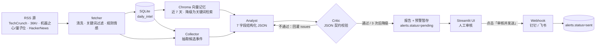

# AI Pulse · AI 行业情报监控中枢

一个可端到端运行的 AI 情报看板：**RSS 实时采集 → Chroma 历史记忆 → Collector / Analyst / Critic 多 Agent 协作 → 人工审核 → Webhook 推送**。

不是静态 Mock：新闻来自真实 RSS，分析由 DeepSeek 真实调用生成，每次调用的 token 与耗时都落库可查。

---

## 架构



## 技术亮点

1. **纯代码状态机替代 LangGraph**：`Collector → Analyst → Critic` 的 State / Node / Conditional Edge 语义用约 60 行 dataclass + 循环实现，零框架依赖，流程可读可测。
2. **Critic 契约校验 + Reflexion 重试**：校验字段齐全、热度区间、百分比格式、预警条数不超过输入条数、成熟度表格结构、文案长度；不合格把 issues 回灌给 Analyst，最多 3 次，仍失败则规则降级。`python -m agents.graph --force-bad` 可复现 8 类打回。
3. **RAG 双层降级**：Chroma `intel_history` 集合按 7 天窗口做 cosine 召回；嵌入用字符 1/2-gram 哈希离线生成，不依赖模型下载；Chroma 不可用时自动退到字符二元组 Jaccard 检索。
4. **成本可观测**：每次 LLM 调用的 prompt / completion tokens 与耗时写入 `llm_calls`，终端打印 `[COST] Analyst 1901+... tok · 4.2s`，按 `run_id` 可审计。
5. **Human-in-the-loop**：预警只落 `alerts` 表且状态为 `pending`，必须在 UI 点击「审核并发送」才真正推送；失败可重发，成功后记 `sent` 与回执。
6. **全链路可降级**：无 API Key、网络异常、JSON 非法、向量库不可用时都能产出可用报告，页面不白屏。

## 快速启动

```powershell
python -m venv .venv
.\.venv\Scripts\pip.exe install -r requirements.txt
Copy-Item .env.example .env    # 填 DEEPSEEK_API_KEY / WEBHOOK_URL
.\.venv\Scripts\streamlit.exe run app.py
```

打开 `http://localhost:8501`。

可选：每天 08:00 自动跑一次

```powershell
.\.venv\Scripts\python.exe scheduler_service.py        # 常驻
.\.venv\Scripts\python.exe scheduler_service.py --now  # 立即跑一次
```

## 2 分钟演示脚本

| 时间 | 动作 | 讲什么 |
| --- | --- | --- |
| 0:00 | 停在页面顶部 | 痛点：每天要扫 4 个源，人工筛太慢；直接把新闻丢给 LLM 又会编造数据 |
| 0:20 | 指架构（本页 README 或口述） | 采集 → 历史记忆 → 三 Agent 互相校验 → 人工闸门，四层各解决一个问题 |
| 0:35 | 点右上角「立即更新情报」 | 看底部日志：`[OK]` 各源命中、`[RAG]` 入库与召回、`[COST]` token、`[AGENT]` Critic 第几次通过 |
| 1:05 | 看 3 个 KPI + 两张图 | 热度趋势来自 SQLite 实际条数，情绪分布是三层堆叠 |
| 1:20 | 报告区 | `top_news` / 成熟度表格 / 「历史对比」周同比，全部由模型按契约输出 |
| 1:35 | 展开「Agent 执行轨迹」 | 每个节点的 token 与耗时、Critic 是否重试、RAG 召回的 6 条历史及相似度 |
| 1:50 | 点「演示 HITL · 生成待审批预警」→「审核并发送」 | 预警先 pending，人工确认后才推送，状态变 ✅ 已推送 |
| 2:00 | 收尾 | 换成钉钉机器人即可上线；任何环节失败都有规则降级，不会空屏 |

> 演示用预警带 `[DEMO]` 前缀，明确标注为样例，不冒充当日真实新闻。

## 高频问答

**Q1：为什么不用 LangGraph？**
三个节点串行、只有一条回边，状态机 60 行就能表达；引入框架换来的是复杂调度与调试成本，而不是业务收益。真要做并行分支或持久化检查点再引入不迟。

**Q2：Critic 怎么防幻觉？**
它不判断事实真伪，而是校验**可验证的契约**：字段齐全、数值区间、百分比格式、预警条数不能超过输入条数、表格结构、文案长度；不合格把具体 issues 回灌给 Analyst 重写（Reflexion）。事实层靠 RAG 上下文注入，并要求 `comparison` 必须复用历史对比结论、不得自行编造百分比。

**Q3：RAG 召回的相关性怎么保证？**
先按 `day_index` 过滤近 7 天再算 cosine，避免跨时间污染；召回结果会进入 Analyst 的 Prompt。嵌入是字符 n-gram 哈希，离线可跑，中文同义词召回弱于语义模型——这是有意的取舍，降级路径保证不可用时仍能检索。

**Q4：HITL 为什么用 SQLite 状态机而不是消息队列？**
单机部署、需要跨 Streamlit 会话持久化；`pending / sent / failed` 三态 + `push_result` 足够表达审批链路，MQ 会额外引入运维面。

**Q5：降级触发条件有哪些？**
无 `DEEPSEEK_API_KEY`；请求异常或非 200；JSON 无法解析；Critic 连续 3 次不通过；Chroma 初始化或查询失败。每条降级都会在日志里标明原因。

**Q6：token 成本怎么控？**
一次 run 通常 2 次调用（Collector + Analyst），Critic 是规则校验不花 token；重试上限 3 次；`max_tokens` 有上限；每次调用按 `run_id` 落库，可直接汇总。

**Q7：重复抓取怎么处理？**
`daily_intel` 以 `(date, title)` 唯一去重，Chroma 以 `date|title` 的 SHA1 做幂等 upsert。已知缺陷：同一条新闻只归属首次命中的关键词，跨关键词统计会漏——已在「已知限制」中列出。

**Q8：这个项目最大的不足是什么？**
没有鉴权、没有测试、单机 SQLite、情感判定依赖词表。生产化需要补登录与审批人记录、加锁避免并发 run、给抓取加增量游标、把配置与数据源注册表化。

## 已知限制

- 无登录鉴权：任何能访问页面的人都能触发更新与审批推送。
- 无自动化测试；仅有 `--force-bad`、`python -m llm.client` 等手工自测入口。
- 单机 SQLite + 本机 Chroma，未做多实例并发控制。
- 情感标签来自词表规则，负面覆盖不足；LLM 模式下由 Collector 重新判定。
- 数据源与关键词为硬编码常量，`Twitter/X` 无公开 RSS。
- `.env` 明文保存密钥；`WEBHOOK_URL` 建议指向自己的钉钉/飞书机器人。

## 目录

```
app.py                Streamlit 页面（布局、图表、HITL 按钮、执行轨迹）
pipeline.py           一次 run 的编排：抓取 → RAG → Agent → 预警暂存
fetcher.py            RSS 抓取、清洗、关键词匹配、规则情感
database.py           SQLite：资讯、run_logs、llm_calls、alerts
llm/client.py         DeepSeek JSON Mode 封装 + token/耗时计量
agents/               state / prompts / collector / analyst / critic / graph
rag/store.py          Chroma 向量记忆 + 关键词降级检索
rag/memory.py         历史召回上下文与周同比
notify.py             钉钉 / 飞书 Webhook（含加签）
scheduler_service.py  APScheduler 每日 08:00
```
