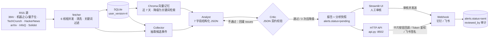

# AI Pulse · AI 行业情报监控中枢

一个可端到端运行的 AI 情报看板：**RSS 实时采集 → Chroma 历史记忆 → Collector / Analyst / Critic 多 Agent 协作 → 人工审核 → Webhook 推送**，并附带 HTTP API 与飞书卡片审批。

不是静态 Mock：新闻来自真实 RSS，分析由 DeepSeek 真实调用生成，每次调用的 token 与耗时都落库可查。**当前版本已完成 P0–P3 全部功能点，并完成 2026-10-30 的 21 项可靠性 / 安全提升；HTTP API 支持 Token 鉴权与飞书签名校验，UI 仍默认只监听本机。**

## 目录

- [它解决什么问题](#它解决什么问题)
- [整体架构](#整体架构)
- [一次 run 的完整流程](#一次-run-的完整流程)
- [多 Agent 状态机](#多-agent-状态机)
- [技术亮点](#技术亮点)
- [功能清单（P0–P3）](#功能清单p0p3)
- [数据模型](#数据模型)
- [数据源与关键词](#数据源与关键词)
- [HTTP API](#http-api)
- [配置项](#配置项)
- [快速启动](#快速启动)
- [运维](#运维)
- [测试](#测试)
- [常见问题](#常见问题)
- [已知限制](#已知限制)
- [目录结构](#目录结构)
- [后续可选方向](#后续可选方向)

---

## 它解决什么问题

每天要扫 7 个中英文源，人工筛完再判断"这条算不算风险"，既慢又不稳定；直接把新闻丢给大模型，又会编造热度和百分比。

这套系统的做法是把"能不能信"拆成四道关：

1. **采集关**：只抓公开 RSS，按中英文别名匹配关键词，同一内容多源去重。
2. **记忆关**：过去 7 天的资讯进向量库，分析时必须参考历史基线，不允许凭空编同比。
3. **校验关**：Analyst 输出的每个字段都要过 Critic 的契约检查，不合格打回重写，最多 3 次。
4. **人工关**：可能的风险预警只落库为 `pending`，人点了"审核并发送"才真正推送。

任何一层失败都有规则降级，页面不会白屏，也不会因为某天网络差就完全没内容。

## 整体架构



分层说明：

| 层 | 组成 | 职责 |
| --- | --- | --- |
| 采集层 | `fetcher.py` + `sources.py` | 并发抓 RSS、清洗 HTML、关键词/别名匹配、规则情感打分 |
| 存储层 | `database.py` + SQLite(WAL) | 资讯、运行记录、调用成本、预警、事件线、分析快照、归档 |
| 记忆层 | `rag/store.py` + `rag/memory.py` | 近 7 天向量入库、相似召回、周同比基线 |
| 决策层 | `agents/` + `llm/client.py` | Collector → Analyst → Critic 状态机，JSON Mode 调用与成本计量 |
| 闸门层 | `pipeline.py` + `notify.py` | 运行锁、冷却、预警落库、人工审批后推送 |
| 交付层 | `app.py` + `ui/` + `api.py` | Streamlit 看板与 HTTP API，共用同一套数据与规则 |

## 一次 run 的完整流程

`pipeline.run(keyword, sources, trigger)` 是所有入口（UI 按钮 / API / 调度器 / CLI）的唯一入口：

1. **获取跨进程运行锁**：`.pulse.lock` 用 `O_CREAT|O_EXCL` 原子创建，记录 pid；超过 30 分钟的残留锁会被检测并抢占，避免进程崩溃后永久卡死。
2. **过期预警清理**：超过 24 小时未审核的 `pending` 预警自动置为 `expired`。
3. **冷却检查**：同一关键词距上次成功 run 不足 `RUN_COOLDOWN_SECONDS`（默认 90s）直接拒绝，UI 禁用按钮、API 返回 429。
4. **并发抓取**：`fetcher.fetch_all()` 用 6 线程抓 7 个源，单源 5 秒超时，整轮 12 秒是**共享截止时间**（`wait(timeout=...)`，慢源不会让后续源饿死）；成功结果缓存 180 秒、失败源冷却 300 秒；机器之心 RSS 失效时自动回退量子位。
5. **清洗与筛选**：去 HTML 标签、压缩空白、按别名表匹配关键词，同标题多源只留一条，摘要截断到 160 字。
6. **增量判断**：`filter_unseen()` 用 `(date, title, keyword)` 识别真正的新条目；本次无新增时回退最近 1 天存档继续分析，避免"空跑"。
7. **入库**：`save_items()` 写 `daily_intel`，同日期同标题同关键词幂等。
8. **向量记忆**：`rag_store.index_items()` 把本次资讯幂等 upsert 进 Chroma；`build_context()` 召回近 7 天相似资讯并计算周同比。
9. **多 Agent 分析**：`agents.graph.run()` 依次执行 Collector / Analyst / Critic，Critic 打回时最多重试 3 次，仍失败则规则降级。
10. **热度校正**：`pipeline.compute_heat()` 用资讯条数与命中源数算出 800–2000 的热度，覆盖模型自报值（防幻觉）。
11. **情感回写**：把 Agent 判定的情感写回 `daily_intel`，页面统计口径与报告一致。
12. **事件线归并**：`events.link_run()` 用标题二元组相似度（阈值 0.5，实体命中 +0.2）把多来源同一事件归到一条线，活跃窗口 7 天。
13. **分析落库**：`database.save_analysis()` 存完整快照到 `analyses`，刷新页面仍可回放。
14. **预警暂存**：`negative_alerts > 0` 时写 `alerts`（状态 `pending`），同日同关键词复用同一条记录，不重复生成。
15. **日报导出**：`reports.save()` 写 `reports/YYYY-MM-DD-{keyword}.md`。
16. **收尾**：回写 `run_logs`（状态、条数、耗时、模式、错误），释放运行锁。

推送不在本流程内：人工在 UI 或飞书卡片点"通过"后，才走 `pipeline.push_alert()` 调用 Webhook。

## 多 Agent 状态机

不引入 LangGraph，用 `agents/state.py` 的 dataclass + `agents/graph.py` 的循环表达 State / Node / Conditional Edge：

| 节点 | 输入 | 输出 | 失败策略 |
| --- | --- | --- | --- |
| Collector | 资讯标题 + 摘要 | 候选事件（标题、情感、实体） | 模型不可用时用规则提取 |
| Analyst | 候选事件 + RAG 上下文 + 上轮 issues | 7 字段 JSON 草稿 | 模型不可用或解析失败时用规则分析 |
| Critic | 草稿 + 输入资讯 | issues 列表（空 = 通过） | 纯规则，不消耗 token |

**Critic 的 7 条契约**（`agents/critic.py`）：

1. 字段齐全：`heat_score` / `positive_ratio` / `negative_alerts` / `top_news` / `maturity` / `warning_text` / `comparison`。
2. `heat_score` 必须是 800–2000 的整数。
3. `positive_ratio` 必须是 `65%` 这种百分数字符串，且落在 0–100。
4. `negative_alerts` 是 0–5 的整数，且不能超过本轮输入资讯条数。
5. `top_news` 至少 3 条 `- ` 列表，且短标题必须能在输入标题里核验（包含或字符重合度 ≥ 0.6）。
6. `maturity` 必须是以 `| 方向 | 成熟度 | 阶段判断 |` 为表头的 3–5 行 Markdown 表格。
7. `warning_text` 长度 30–200 字（无风险时也要在这个区间内说明「暂无高风险事件」）；`comparison` 非空且必须复用历史对比结论。

打回时 issues 会回灌给 Analyst 重写（Reflexion 风格），最多 3 次；`python -m agents.graph --force-bad` 可复现全部打回类型。

## 技术亮点

1. **纯代码状态机替代 LangGraph**：三个节点 + 一条回边，约 60 行 dataclass + 循环就够；零框架依赖，流程可读、可断点、可单测。
2. **Critic 契约校验 + Reflexion 重试**：不判断事实真伪，只校验可验证的结构与数值，打回理由具体到字段，避免"模型自评通过"。
3. **RAG 双层降级 + 关键词隔离**：Chroma `intel_history` 集合按 `day_index` 过滤近 7 天、再按 `keyword` 过滤后算 cosine；多个查询文本（收藏标题 + 今日标题）合并成一次多查询召回，按标题去重保留最高相似度；嵌入用字符 1/2-gram 哈希离线生成，不下载模型；Chroma 不可用时自动退到字符二元组 Jaccard 检索（同样按关键词过滤），并 5 分钟后重试。周同比改为「近 7 天 vs 上一个 7 天」，避免单日噪声。
4. **成本可观测**：每次 LLM 调用的 prompt / completion tokens 与耗时写 `llm_calls`，日志打印 `[COST] Analyst 860+329 tok · 3.2s`，可按 `run_id` 审计。
5. **Human-in-the-loop**：预警只落 `alerts` 且状态 `pending`，人工确认后才推送；审批人、备注、回执全部落库（`reviewed_by` / `review_note` / `push_result`）。
6. **全链路可降级**：无 API Key、网络异常、JSON 非法、向量库不可用、Critic 连败，都能产出可用报告，页面不白屏。
7. **HTTP API + 飞书卡片审批**：标准库 `http.server` 暴露 12 个端点；配置 `API_TOKEN` 后除健康检查与飞书回调外全部要求 Token，飞书回调支持 `X-Lark-Signature` 签名校验；审批用 `claim_alert()` 原子抢占（`sending` 中间态），并发审批不会重复推送；API 与 UI 共用同一套运行锁、冷却与审批逻辑。
8. **Prompt 注入防护**：所有外部文本（今日资讯与历史记忆）都用 `<<<UNTRUSTED_DATA>>>` 边界包裹，并屏蔽"忽略以上指令"类注入句式，模型无法伪造闭合标记。
9. **可运维**：日志双写 `logs/pulse.log`（2MB × 3 轮转）；`database.py --stats / --archive-days` 做容量统计与冷热归档；Dockerfile + compose + Caddyfile 一键容器化。
10. **配置收敛**：数据源、关键词、别名只在 `sources.py` 注册一次，UI / 调度器 / API / fetcher 全部从这里取值。

## 功能清单（P0–P3）

| 阶段 | 能力 | 状态 |
| --- | --- | --- |
| P0 | 跨进程运行锁、pytest + CI、UI 拆分、Chroma/LLM 重试退避、预警去重与过期 | ✅ |
| P1 | 数据源注册表、跨关键词归属、情感口径统一、防幻觉补丁、多关键词调度、增量抓取、日报导出 | ✅ |
| P2 | 事件线追踪、HTTP API、审批审计、飞书卡片回调审批、数据归档、Docker 部署 | ✅ |
| P3 | Prompt 注入防护、密钥掩码治理、日志文件化、按钮冷却、分析结果持久化回放 | ✅ |
| 2026-10-30 提升 | API Token 鉴权 / 飞书签名 / CORS 白名单、审批原子抢占、共享抓取预算、RAG 多查询与关键词隔离、7 天窗口周同比、热度与正面占比代码校正、Prompt/Critic 契约对齐、情感词表与文本工具收敛、Webhook 重试、页面缓存与审批历史、演示预警标记（`user_version=4`）、依赖锁定、ruff + coverage CI、非 root 容器与北京时间 | ✅ |

## 数据模型

SQLite（WAL）共 9 张表，`PRAGMA user_version` 记录迁移版本：

| 表 | 用途 | 关键约束 |
| --- | --- | --- |
| `daily_intel` | 抓取到的资讯 | `UNIQUE(date, title, keyword)`（v1 迁移） |
| `run_logs` | 每次 run 的状态 / 条数 / 耗时 / 错误 | `run_id` 主键；冷却依据最近成功记录 |
| `llm_calls` | 每次模型调用的 token / 耗时 / 成败 | 按 `run_id + node` 可审计 |
| `alerts` | 预警与审批状态 | 六态 `pending/sending/sent/failed/expired/rejected`；v3 加 `reviewed_by` / `review_note`，v4 加 `is_demo` |
| `event_threads` | 事件线：实体、首末日期、报道数 | `thread_key` 唯一（v2 新增） |
| `event_links` | 事件线 ↔ 资讯明细 | `UNIQUE(thread_id, title)` 防重复计数（v2 新增） |
| `analyses` | 每次 run 的完整分析快照（JSON） | `run_id` 主键，刷新可回放（v3 新增） |
| `daily_intel_archive` | 超期资讯冷数据 | 与 `daily_intel` 同构（v3 新增） |
| `llm_calls_archive` | 超期调用记录冷数据 | 与 `llm_calls` 同构（v3 新增） |

迁移历史：v1 唯一键加 `keyword`；v2 事件线两表；v3 审批审计字段 + 分析快照 + 归档表；v4 `alerts.is_demo` 标记演示预警，审批历史默认可与真实预警区分。

## 数据源与关键词

数据源（`sources.py`，按顺序尝试，失败自动回退）：

| 逻辑源 | 实际源 | 说明 |
| --- | --- | --- |
| 36Kr | 36Kr | 中文科技媒体 |
| 机器之心 | 机器之心 → 量子位 | 官方 RSS 已返回 HTML，失败自动回退量子位 |
| HackerNews | HackerNews | 关键词检索型，使用英文检索词 |
| TechCrunch | TechCrunch AI | 英文 AI 频道 |
| arXiv | arXiv cs.AI | 论文速递 |
| InfoQ | InfoQ 中文 | 中文技术媒体 |
| Solidot | Solidot | 中文科技资讯 |

监控关键词：`大模型` / `AI Agent` / `具身智能` / `RAG`。每个关键词都维护中英文别名表；HackerNews 使用 `LLM` / `agent` / `robot` / `RAG` 作为检索词。

新增关键词或数据源只需改 `sources.py` 一处，UI、调度器、API 自动生效。

## HTTP API

```powershell
.\.venv\Scripts\python.exe api.py          # 默认 127.0.0.1:8502
```

| 方法 | 路径 | 参数 | 说明 |
| --- | --- | --- | --- |
| GET | `/api/health` | - | 就绪检查：`db.ok` + 向量库状态 + 运行锁；数据库不可用返回 `503` |
| GET | `/api/status` | - | 运行锁、冷却秒数、最近 3 次 run、关键词与源 |
| GET | `/api/keywords` | - | 关键词与数据源清单 |
| GET | `/api/alerts` | `keyword` / `status` / `limit`(≤200) | 预警列表，按 id 倒序 |
| GET | `/api/threads` | `keyword` / `days`(默认 7) / `limit`(≤100) | 事件线 |
| GET | `/api/intel` | `keyword` / `days`(默认 7) / `limit`(≤500) | 资讯明细与总数 |
| GET | `/api/runs` | `limit`(≤100) | 运行历史 |
| GET | `/api/cost` | - | 累计调用次数与 token / 耗时 |
| GET | `/api/storage` | - | 各表容量 |
| POST | `/api/run` | `keyword` / `sources` / `trigger` / `wait` | 触发一次 run |
| POST | `/api/approve` | `alert_id` / `action`(approve 或 reject) / `reviewed_by` / `review_note` | 审批 |
| POST | `/api/callback/feishu` | 飞书卡片回调体 | `url_verification` 返回 challenge；配置密钥后校验签名，按钮点击直接审批 |

**鉴权**：在 `.env` 设置 `API_TOKEN` 后，除 `/api/health` 与 `/api/callback/feishu`（后者靠飞书签名校验）外，所有端点都要求：

```powershell
# 二选一
-H "X-API-Token: <token>"
-H "Authorization: Bearer <token>"
```

未配置 `API_TOKEN` 时不鉴权，仅适合本机调试。CORS 默认不发头；需要浏览器跨域时再设 `CORS_ALLOW_ORIGIN`（`*` 或逗号分隔白名单）。

`POST /api/run` 行为：

- `wait=true`：同步执行并返回 `run_id / items / inserted / alert_id / duration_ms / mode / analysis`。
- `wait=false`（默认）：先检查运行锁，无冲突才启动后台线程并返回 `202`。
- 关键词不在注册表：`400`；`sources` 全无效：`400`；运行锁被占：`409`；冷却中：`429` 且带 `retry_after`。
- 所有查询参数做整数校验与范围夹紧，非法值统一返回 `400`（例如 `/api/intel?days=abc`）。

示例：

```powershell
# 同步跑一次
Invoke-RestMethod -Method Post http://127.0.0.1:8502/api/run `
  -ContentType "application/json" `
  -Body '{"keyword":"AI Agent","wait":true}'

# 审批通过
Invoke-RestMethod -Method Post http://127.0.0.1:8502/api/approve `
  -ContentType "application/json" `
  -Body '{"alert_id":1,"action":"approve","reviewed_by":"karry","review_note":"已确认"}'
```

## 配置项

复制 `.env.example` 为 `.env`：

| 变量 | 必填 | 说明 |
| --- | --- | --- |
| `DEEPSEEK_API_KEY` | ✅ | 未配置时自动降级为规则分析 |
| `WEBHOOK_URL` | 否 | 钉钉或飞书机器人地址，按域名自动识别渠道 |
| `DINGTALK_SECRET` | 否 | 钉钉加签密钥（推荐加签模式） |
| `PUBLIC_BASE_URL` | 否 | 公网可达地址；配置后飞书卡片才带审批按钮 |
| `API_TOKEN` | 否（公网必填） | 配置后 API 需 `X-API-Token` 或 `Authorization: Bearer` |
| `FEISHU_VERIFICATION_TOKEN` | 否 | 飞书事件订阅 verification token |
| `FEISHU_ENCRYPT_KEY` | 否 | 飞书回调签名密钥；配置后校验 `sha256(timestamp+nonce+key+body)` |
| `CORS_ALLOW_ORIGIN` | 否 | CORS 白名单：`*` 或逗号分隔来源；默认不发 CORS 头 |
| `RUN_COOLDOWN_SECONDS` | 否 | 同关键词触发冷却，默认 90，`0` 关闭 |
| `PULSE_DB_PATH` / `PULSE_LOG_DIR` / `PULSE_CHROMA_DIR` | 否 | 容器部署时指向挂载卷（`/data` 与 `/data/chroma`） |

代码内可调参数：

| 参数 | 位置 | 默认 | 含义 |
| --- | --- | --- | --- |
| `FETCH_WORKERS` | `fetcher.py` | 6 | 并发抓取线程数 |
| `FETCH_BUDGET` | `fetcher.py` | 12s | 整轮抓取**共享截止时间**（不是单源顺序预算） |
| `CACHE_TTL` / `FAIL_TTL` | `fetcher.py` | 180s / 300s | 成功缓存 / 失败冷却 |
| `WEBHOOK_RETRIES` | `notify.py` | 2 | Webhook 可重试状态（429/5xx）最多再试 2 次 |
| `MAX_ATTEMPTS` | `agents/graph.py` | 3 | Critic 最大重试次数 |
| `WINDOW_DAYS` / `SIMILARITY` | `events.py` | 7 天 / 0.5 | 事件线窗口与归并阈值 |
| `RETRY_COOLDOWN` | `rag/store.py` | 300s | 向量库失败后的重试冷却 |
| 审批 stale 窗口 | `database.claim_alert` | 10 分钟 | 超过 10 分钟卡在 `sending` 才允许重新抢占 |
| `MAX_BYTES` / `BACKUP_COUNT` | `logging_setup.py` | 2MB × 3 | 日志轮转 |

## 快速启动

```powershell
python -m venv .venv
.\.venv\Scripts\pip.exe install -r requirements.txt
Copy-Item .env.example .env    # 填 DEEPSEEK_API_KEY / WEBHOOK_URL
.\.venv\Scripts\streamlit.exe run app.py
```

打开 `http://localhost:8501`。

容器化（共享一个数据卷；`sched` / `https` 为可选 profile）：

```powershell
docker compose up -d ui api
docker compose --profile sched up -d scheduler
docker compose --profile https up -d caddy
```

可选：每天 08:00 自动跑一次（默认关闭，需先 `--enable`）

```powershell
.\.venv\Scripts\python.exe scheduler_service.py --status   # 查看当前状态
.\.venv\Scripts\python.exe scheduler_service.py --disable  # 关闭并禁止自启
.\.venv\Scripts\python.exe scheduler_service.py --enable   # 解除禁用
.\.venv\Scripts\python.exe scheduler_service.py             # 常驻（需已启用）
.\.venv\Scripts\python.exe scheduler_service.py --now       # 立即跑一次
```

每次 run 结束会在 `reports/` 下生成 `YYYY-MM-DD-{keyword}.md` 日报（已 gitignore）。

## 运维

```powershell
.\.venv\Scripts\python.exe database.py --stats                     # 各表容量
.\.venv\Scripts\python.exe database.py --archive-days 90 --dry-run # 归档演练（只统计）
.\.venv\Scripts\python.exe database.py --archive-days 90           # 冷热分离并清理热表
Get-Content logs\pulse.log -Tail 50                                # 最近日志
```

- **日志**：`logs/pulse.log`，2MB 轮转、保留 3 份；UI 面板与文件同时写入，API 路径已去重不会重复落盘。
- **冷热归档**：超过 90 天的 `daily_intel` / `llm_calls` 搬入 `*_archive` 表，热表保持轻量。
- **分析快照**：每次 run 的结果存 `analyses`，刷新页面自动回放。
- **运行锁**：`.pulse.lock` 残留超过 30 分钟会被下一次 run 抢占，异常退出不会永久卡死。
- **就绪检查**：`GET /api/health` 返回 `db.ok / rag / lock`；数据库不可用返回 503，compose 已内置 healthcheck。

## 测试

```powershell
.\.venv\Scripts\pip.exe install -r requirements-dev.txt
.\.venv\Scripts\python.exe -m pytest -q     # 131 passed
.\.venv\Scripts\ruff.exe check .            # All checks passed
```

覆盖范围：Critic 契约校验、抓取与清洗纯函数、SQLite 持久层与 v1–v4 迁移、审批原子抢占与演示标记、数据源注册表、调度编排、运行锁与冷却、日报渲染、事件线归并、RAG 退化与关键词隔离、API 全端点（鉴权 / 飞书签名 / 参数 400 / 就绪检查）、Prompt 注入防护、日志落盘、归档与分析回放。

CI：`.github/workflows/ci.yml`（ruff + coverage + pytest）。

## 常见问题

**Q1：为什么不用 LangGraph？**
三个节点串行、只有一条回边，状态机 60 行就能表达；引入框架换来的是复杂调度与调试成本，而不是业务收益。真要做并行分支或持久化检查点再引入不迟。

**Q2：Critic 怎么防幻觉？**
它不判断事实真伪，而是校验**可验证的契约**：字段齐全、数值区间、百分比格式、预警条数不能超过输入条数、表格结构、文案长度、短标题必须能在输入里核验；不合格把具体 issues 回灌给 Analyst 重写（Reflexion）。事实层靠 RAG 上下文注入，并要求 `comparison` 必须复用历史对比结论、不得自行编造百分比。

**Q3：RAG 召回的相关性怎么保证？**
先按 `day_index` 过滤近 7 天、再按 `keyword` 过滤，避免跨时间与跨关键词污染；多个查询文本合并为一次多查询召回，按标题去重保留最高相似度。嵌入是字符 n-gram 哈希，离线可跑，中文同义词召回弱于语义模型——这是有意的取舍，降级路径保证不可用时仍能检索。

**Q4：HITL 为什么用 SQLite 状态机而不是消息队列？**
单机部署、需要跨 Streamlit 会话持久化；`pending / sending / sent / failed / expired / rejected` 六态 + `push_result` + `reviewed_by` 足够表达审批链路，MQ 会额外引入运维面。`sending` 是推送中的原子抢占态，只有 `claim_alert()` 成功的一方能真正调用 Webhook。

**Q5：降级触发条件有哪些？**
无 `DEEPSEEK_API_KEY`；请求异常或非 200；JSON 无法解析；Critic 连续 3 次不通过；Chroma 初始化或查询失败；抓取超预算。每条降级都会在日志里标明原因。

**Q6：token 成本怎么控？**
一次 run 通常 2 次调用（Collector + Analyst），Critic 是规则校验不花 token；重试上限 3 次；`max_tokens` 有上限；每次调用按 `run_id` 落库，可直接汇总。

**Q7：重复抓取怎么处理？**
`daily_intel` 以 `(date, title, keyword)` 唯一去重，同一条新闻可同时归属多个关键词；每次 run 前用 `filter_unseen` 只把新条目送去分析，已入库的跳过。Chroma 以 `date|title` 的 SHA1 做幂等 upsert。

**Q8：外部资讯会不会操纵模型？**
所有抓取文本在进入 Prompt 前都会被 `<<<UNTRUSTED_DATA>>>` / `<<<END_UNTRUSTED_DATA>>>` 包裹，并清洗"忽略以上指令""你现在是"等注入句式；模型即使被诱导，也只能在数据边界内作答。

**Q9：为什么同关键词 90 秒内不能重复跑？**
抓源有缓存与预算，连续点击既浪费 token 也不会更快；冷却把最近一次成功 run 的时间写进 `run_logs`，UI 与 API 共用同一判断。需要频繁演示时可设 `RUN_COOLDOWN_SECONDS=0`。

**Q10：这个项目最大的不足是什么？**
单机 SQLite、情感判定依赖词表、Streamlit 页面本身没有登录。API 已补 Token 鉴权，数据源与关键词已收敛到 `sources.py`，审批人已落库；生产化还需要给 UI 加登录、把调度从单机常驻进程迁到受管 cron。

## 已知限制

- **UI 无登录**：HTTP API 已有 `API_TOKEN` 鉴权，但 Streamlit 页面本身没有账号体系；UI / API 默认都只绑定 `127.0.0.1`，对外仍需反向代理认证。
- 单机 SQLite + 本机 Chroma；已加跨进程运行锁（`.pulse.lock`），多实例部署仍未验证。
- 情感标签先用词表规则打底，LLM 模式下由 Collector 重新判定并回写；无 Key 时仍以词表为准。
- 向量嵌入是字符 n-gram 哈希，不是语义模型；中文同义词召回偏弱，但完全离线、零下载。
- 数据源与关键词统一在 `sources.py`，`Twitter/X` 无公开 RSS 已移除。
- `.env` 明文保存密钥；`WEBHOOK_URL` 建议指向自己的钉钉/飞书机器人。
- 飞书卡片审批按钮需要配置 `PUBLIC_BASE_URL`（公网可达的回调地址），否则只发纯文本卡片。
- 同一关键词 90 秒内只允许触发一次（`RUN_COOLDOWN_SECONDS=0` 可关闭）。

## 目录结构

```
app.py                Streamlit 页面（布局、KPI、HITL 按钮、日志面板）
ui/style.css          页面全局样式（从 app.py 抽出）
ui/charts.py          Plotly 图表构建
ui/trace.py           Agent 执行轨迹与事件线面板
pipeline.py           一次 run 的编排：锁 → 抓取 → RAG → Agent → 预警 → 日报
fetcher.py            RSS 并发抓取、清洗、关键词匹配、缓存与共享预算
textutils.py          文本归一化 / 二元组 / 标题与 URL 规范化（跨模块唯一实现）
sentiment.py          情感词表与规则打分（fetcher / analyst 共用）
sources.py            数据源 / 关键词 / 检索词 / 别名唯一注册表
reports.py            Markdown 日报导出
database.py           SQLite 九张表、迁移、去重、分析快照、归档、容量统计
api.py                HTTP API（标准库） + 飞书卡片回调审批
logging_setup.py      统一日志：控制台 + logs/pulse.log 轮转
llm/client.py         DeepSeek JSON Mode 封装 + token/耗时计量 + 重试退避
agents/state.py       AgentState：输入、草稿、issues、模式、降级标记
agents/prompts.py     Prompt 模板 + 不可信数据边界 + 注入句式清洗
agents/collector.py   Collector 节点
agents/analyst.py     Analyst 节点（含规则降级）
agents/critic.py      Critic 契约校验与结果归一
agents/graph.py       状态机主循环（≤3 次回边）
rag/store.py          Chroma 向量记忆 + 关键词降级检索
rag/memory.py         历史召回上下文与周同比
notify.py             钉钉 / 飞书 Webhook（含加签、卡片按钮）
scheduler_service.py  APScheduler 每日 08:00，多关键词串行
Dockerfile            ui / api 共用镜像（非 root 用户 · TZ=Asia/Shanghai · /data/chroma）
docker-compose.yml    ui + api + scheduler + caddy（可选 profile）
deploy/Caddyfile      域名反代：/_stcore/* → ui，/api/* → api
.env.example          环境变量模板
requirements.txt      运行依赖（已按当前环境锁定版本）
requirements-dev.txt  测试 / 静态检查（pytest · ruff · coverage）
pyproject.toml        pytest / ruff / coverage 配置
tests/                pytest 用例（131）
docs/ARCHITECTURE.md  架构分析与迭代路线图
```

## 后续可选方向

- **UI 登录与多用户**：接入 OIDC 或反向代理 Basic Auth，把 `reviewed_by` 与真实账号绑定（API Token 已完成）。
- **调度托管化**：把常驻 APScheduler 换成受管 cron / 云函数，减少单机依赖。
- **召回升级**：接入真实 embedding 模型或混合检索（BM25 + 向量），提升中文同义召回。
- **运营看板**：基于 `run_logs` / `llm_calls` 聚合 Critic 一次通过率、误报率、单 run 成本曲线。
