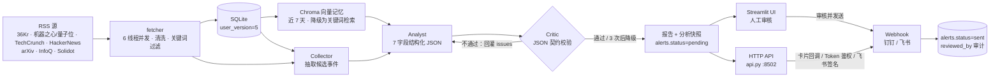

# AI Pulse 技术文档（2026-10-30）

> 文档性质：本仓库**唯一技术文档**，合并自项目 `README.md`、原架构文档与原验证报告，去重后保留最完整表述（原两篇已归档删除，后续只维护本文）。
> 读者对象：面试官、接手开发者、未来的自己。
> 事实基准：以 2026-10-30 的最终回归快照为准（`pytest` 191 passed、覆盖率 77%、`user_version=5`、UI 层 app.py 86% / trace 与 charts 100%）。
> 阅读路径建议：只想知道做了什么 → 第一、三章；要看实现 → 四、五、六、七；要评估质量 → 十一、十二、十三、十五；面试速成 → 十八。

## 目录

- [一、项目一句话与目标](#一项目一句话与目标)
- [二、快速开始](#二快速开始)
- [三、功能清单与用户旅程](#三功能清单与用户旅程)
- [四、架构总览与一次 run 的完整数据流](#四架构总览与一次-run-的完整数据流)
- [五、模块职责与目录结构](#五模块职责与目录结构)
- [六、数据模型](#六数据模型)
- [七、Agent 契约、Critic 校验、降级与补档](#七agent-契约critic-校验降级与补档)
- [八、HITL 人工审批与飞书钉钉推送](#八hitl-人工审批与飞书钉钉推送)
- [九、API 端点与鉴权](#九api-端点与鉴权)
- [十、安全与可靠性设计](#十安全与可靠性设计)
- [十一、运行指标与可观测性](#十一运行指标与可观测性)
- [十二、方案对比实验](#十二方案对比实验)
- [十三、验证与反馈报告](#十三验证与反馈报告)
- [十四、问题清单与修复 changelog](#十四问题清单与修复-changelog)
- [十五、测试与覆盖率](#十五测试与覆盖率)
- [十六、部署与运维](#十六部署与运维)
- [十七、已知限制与后续计划](#十七已知限制与后续计划)
- [十八、面试讲解要点](#十八面试讲解要点)

---

## 一、项目一句话与目标

### 1.1 一句话定位

单机可运行的 AI 行业情报系统——**RSS 抓取 → SQLite → Chroma 历史记忆 → Collector / Analyst / Critic 三 Agent → 事件线归并 → 预警人工审批 → Webhook 推送**，每次 run 额外产出一份 Markdown 日报；附带 HTTP API 与飞书卡片审批。

不是静态 Mock：新闻来自真实 RSS，分析由 DeepSeek 真实调用生成，每次调用的 token 与耗时都落库可查。当前版本已完成 P0–P3 全部功能点，并完成 2026-10-30 的 21 项可靠性 / 安全提升；HTTP API 支持 Token 鉴权与飞书签名校验，UI 仍默认只监听本机。

### 1.2 要解决的问题

每天要扫 7 个中英文源，人工筛完再判断「这条算不算风险」，既慢又不稳定；直接把新闻丢给大模型，又会编造热度和百分比。

这套系统把「能不能信」拆成四道关：

1. **采集关**：只抓公开 RSS，按中英文别名匹配关键词，同一内容多源去重。
2. **记忆关**：过去 7 天的资讯进向量库，分析时必须参考历史基线，不允许凭空编同比。
3. **校验关**：Analyst 输出的每个字段都要过 Critic 的契约检查，不合格打回重写，最多 3 次。
4. **人工关**：可能的风险预警只落库为 `pending`，人点了「审核并发送」才真正推送。

任何一层失败都有规则降级，页面不会白屏，也不会因为某天网络差就完全没内容。

### 1.3 工程评价与定位判断

工程评价：功能闭环 9/10（从抓 RSS 到人工审批推送全链路真跑通，不是 Mock）；代码分层 8/10（依赖单向、无循环导入）；工程质量 9/10（191 个 pytest 用例、覆盖率 77%、ruff / coverage CI、AppTest 冒烟，仍缺类型检查）；生产可用度 7/10（并发锁、Token 鉴权、审批审计、容器化齐备，仍是单机存储）；可扩展性 8/10（数据源 / 关键词已收敛到 `sources.py`，阈值仍硬编码）。

**定位判断**：这是一个「完整度很高的单机情报系统」。P0–P3 与 2026-10-30 的 21 项提升完成后，鉴权、审批审计、事件线、API、容器化都已具备；剩下的短板是 **UI 登录、单机存储上限与语义召回质量**（改进项见第十七章）。

---

## 二、快速开始

### 2.1 安装与启动

```powershell
python -m venv .venv
.\.venv\Scripts\pip.exe install -r requirements.txt
Copy-Item .env.example .env    # 填 DEEPSEEK_API_KEY / WEBHOOK_URL
.\.venv\Scripts\streamlit.exe run app.py      # 页面 http://localhost:8501
.\.venv\Scripts\python.exe api.py            # HTTP API，默认 127.0.0.1:8502
```

不配置 `DEEPSEEK_API_KEY` 也能跑：自动降级为规则分析（`mode=fallback`），页面与日报照常产出。

### 2.2 常用命令

| 用途 | 命令 |
| --- | --- |
| 页面 / HTTP API | `.\.venv\Scripts\streamlit.exe run app.py` / `.\.venv\Scripts\python.exe api.py` |
| 手动跑一次 / 立即调度 | `.\.venv\Scripts\python.exe pipeline.py --keyword "AI Agent"` / `.\.venv\Scripts\python.exe scheduler_service.py --now --keywords "大模型,RAG"` |
| 事件线 / 运行指标 JSON | `.\.venv\Scripts\python.exe events.py --keyword "AI Agent"` / `.\.venv\Scripts\python.exe metrics.py --days 30 --keyword "AI Agent"` |
| 方案对比实验 | `.\.venv\Scripts\python.exe eval\baseline.py --limits 18 --batch 6` |
| 各表容量 / 归档演练 | `.\.venv\Scripts\python.exe database.py --stats` / `.\.venv\Scripts\python.exe database.py --archive-days 90 --dry-run` |
| 数据库备份 | `.\.venv\Scripts\python.exe database.py --backup`（在线备份，保留最近 7 份） |
| 测试 / 静态检查 | `.\.venv\Scripts\python.exe -m pytest -q` / `.\.venv\Scripts\ruff.exe check .` |

### 2.3 环境变量

复制 `.env.example` 为 `.env`：

| 变量 | 必填 | 说明 |
| --- | --- | --- |
| `DEEPSEEK_API_KEY` | 是 | 未配置时自动降级为规则分析 |
| `WEBHOOK_URL` | 否 | 钉钉或飞书机器人地址，按域名自动识别渠道 |
| `DINGTALK_SECRET` | 否 | 钉钉加签密钥（推荐加签模式） |
| `PUBLIC_BASE_URL` | 否 | 公网可达地址；配置后飞书卡片才带审批按钮 |
| `API_TOKEN` | 否（公网必填） | 配置后 API 需 `X-API-Token` 或 `Authorization: Bearer` |
| `FEISHU_VERIFICATION_TOKEN` | 否 | 飞书事件订阅 verification token |
| `FEISHU_ENCRYPT_KEY` | 否 | 飞书回调签名密钥；配置后校验 `sha256(timestamp+nonce+key+body)` |
| `CORS_ALLOW_ORIGIN` | 否 | CORS 白名单：`*` 或逗号分隔来源；默认不发 CORS 头 |
| `RUN_COOLDOWN_SECONDS` | 否 | 同关键词触发冷却，默认 90，`0` 关闭 |
| `PULSE_DB_PATH` / `PULSE_LOG_DIR` / `PULSE_CHROMA_DIR` | 否 | 容器部署时指向挂载卷（`/data` 与 `/data/chroma`） |

代码内可调参数：

| 参数 | 位置 | 默认 | 含义 |
| --- | --- | --- | --- |
| `FETCH_WORKERS` / `FETCH_BUDGET` | `fetcher.py` | 6 / 12s | 并发线程数 / 整轮抓取**共享截止时间**（不是单源顺序预算） |
| `CACHE_TTL` / `FAIL_TTL` | `fetcher.py` | 180s / 300s | 成功缓存 / 失败冷却 |
| `WEBHOOK_RETRIES` | `notify.py` | 2 | Webhook 可重试状态（429/5xx）最多再试 2 次 |
| `MAX_ATTEMPTS` / `MIN_ANALYSIS_ITEMS` | `agents/graph.py` / `pipeline.py` | 3 / 5 | Critic 最大重试次数 / 补档下限（保证 `top_news ≥ 3` 可核验） |
| `WINDOW_DAYS` / `SIMILARITY` | `events.py` | 7 天 / 0.5 | 事件线窗口与归并阈值 |
| `RETRY_COOLDOWN` / 审批 stale 窗口 | `rag/store.py` / `database.claim_alert` | 300s / 10 分钟 | 向量库失败后的重试冷却 / 卡在 `sending` 超过 10 分钟才允许重新抢占 |
| `MAX_BYTES` / `BACKUP_COUNT` | `logging_setup.py` | 2MB × 3 | 日志轮转 |

### 2.4 本地开发注意

- Windows PowerShell 5 不支持 `&&`，多条命令用 `;` 分隔；
- Streamlit 热重载不会刷新被 import 的模块，改 `ui/` 或非入口文件后需重启进程；
- Python 解释器统一用 `.\.venv\Scripts\python.exe`，直接 `python` 可能不是虚拟环境；
- `pulse.db`、`chroma_db/`、`reports/`、`logs/`、`data/`、`.env` 均在 `.gitignore` 中。

---

## 三、功能清单与用户旅程

### 3.1 功能清单（P0–P3 与后续提升）

| 阶段 | 能力 | 状态 |
| --- | --- | --- |
| P0 | 跨进程运行锁、pytest + CI、UI 拆分、Chroma/LLM 重试退避、预警去重与过期 | 已完成 |
| P1 | 数据源注册表、跨关键词归属、情感口径统一、防幻觉补丁、多关键词调度、增量抓取、日报导出 | 已完成 |
| P2 | 事件线追踪、HTTP API、审批审计、飞书卡片回调审批、数据归档、Docker 部署 | 已完成 |
| P3 | Prompt 注入防护、密钥掩码治理、日志文件化、按钮冷却、分析结果持久化回放 | 已完成 |
| 2026-10-30 提升 | API Token 鉴权 / 飞书签名 / CORS 白名单、审批原子抢占、共享抓取预算、RAG 多查询与关键词隔离、7 天窗口周同比、热度与正面占比代码校正、Prompt/Critic 契约对齐、情感词表与文本工具收敛、Webhook 重试、页面缓存与审批历史、演示预警标记、依赖锁定、ruff + coverage CI、非 root 容器与北京时间（共 21 项，清单见 14.6） | 已完成 |
| 复验修复 | P0-1 降级草稿通过契约 / P0-2 库级入口自举 / P0-3 DB 异常降级启动、单条批次补档、运行指标层（`run_logs` v5）、方案对比实验（A/B/C/P）、覆盖率 55% → 77% | 已完成 |

### 3.2 用户旅程（五条典型路径）

10 名同学按以下 5 条路径试用，主路径均能跑通，摩擦集中在离线试跑、KPI 下钻、审批演练三点（评分与痛点见 13.5）。

| 旅程 | 角色任务 | 完成度 | 实测摩擦 |
| --- | --- | --- | --- |
| J1 首次上手 | 复制 `.env.example` → 启动 → 跑一次 → 看报告 | 完成 | 想「不花钱先试」的用户没有显式离线开关，只能填空格或改文件 |
| J2 日常巡检 | 切关键词 → 看 KPI/图表/事件线 → 读日报 | 完成 | KPI 卡片不可下钻；事件线阈值不可解释 |
| J3 风险处置 | 飞书卡片 → 通过/驳回 → 回页面看审批历史 | 部分 | 未配置 `PUBLIC_BASE_URL` 时卡片无按钮，只有纯文本；本地无演练模式不敢真点 |
| J4 集成方 | 读 README → 调 `/api/run` → 轮询 → 审批 | 完成 | 文档与实测一致（12 端点、状态码全对）；但 202 后无 `run_id` 可直接轮询 |
| J5 运维排障 | `/api/health` → 日志 → 残留锁 → 归档 | 曾受阻 | 修复前 DB 异常时进程起不来、health 无从查（现已在 14.4 修复） |

---

## 四、架构总览与一次 run 的完整数据流

### 4.1 架构图



### 4.2 分层职责

| 层 | 组成 | 职责 |
| --- | --- | --- |
| 采集层 | `fetcher.py` + `sources.py` | 并发抓 RSS、清洗 HTML、关键词/别名匹配、规则情感打分 |
| 存储层 | `database.py` + SQLite(WAL) | 资讯、运行记录、调用成本、预警、事件线、分析快照、归档 |
| 记忆层 | `rag/store.py` + `rag/memory.py` | 近 7 天向量入库、相似召回、周同比基线 |
| 决策层 | `agents/` + `llm/client.py` | Collector → Analyst → Critic 状态机，JSON Mode 调用与成本计量 |
| 闸门层 | `pipeline.py` + `notify.py` | 运行锁、冷却、预警落库、人工审批后推送 |
| 交付层 | `app.py` + `ui/` + `api.py` | Streamlit 看板与 HTTP API，共用同一套数据与规则 |

### 4.3 依赖关系（已核对：无循环导入）

```
app.py / scheduler_service.py / api.py ──→ pipeline ──→ fetcher / rag.store / rag.memory / reports / agents.graph
pipeline.push_alert ──→ notify ──→ config        app.py ──→ ui.charts / ui.trace
agents.graph ──→ collector / analyst / critic ──→ llm.client ──→ DeepSeek + database
database / sources / config 被所有人依赖，但自己谁也不依赖（叶子节点）
```

这是**合格的分层**：入口（UI / 调度 / API）→ 编排（pipeline）→ 能力（agents / rag / fetcher）→ 基础设施（llm / database / config）；没有一处 `database` 反过来 import `pipeline`，无循环导入。

### 4.4 一次 run 的完整数据流

`pipeline.run(keyword, sources, trigger)` 是所有入口（UI 按钮 / API / 调度器 / CLI）的唯一入口，顺序如下：

1. **库自举**：入口先幂等调用 `database.init_db()`（P0-2 修复，空库可直接跑）。
2. **跨进程运行锁**：`.pulse.lock` 用 `O_CREAT|O_EXCL` 原子创建并记录 pid；超过 30 分钟的残留锁会被检测并抢占，避免进程崩溃后永久卡死。
3. **开跑前清理与闸门**：`expire_stale_alerts(24h)` 把超时未审的 `pending` 置为 `expired`；`start_run()` 写 `run_logs`（`status=running`）；冷却检查——同关键词距上次成功 run 不足 `RUN_COOLDOWN_SECONDS`（默认 90s）直接拒绝，UI 禁用按钮、API 返回 429。
4. **并发抓取**：`fetcher.fetch_all()` 用 6 线程抓 7 个源，单源 5 秒超时，整轮 12 秒是**共享截止时间**（`wait(timeout=...)`，慢源不会让后续源饿死）；成功结果缓存 180 秒、失败源冷却 300 秒；机器之心 RSS 失效时自动回退量子位。
5. **清洗与筛选**：去 HTML 标签、压缩空白、按别名表匹配关键词，同标题多源只留一条，摘要截断到 160 字。
6. **增量判断**：`filter_unseen()` 用 `(date, title, keyword)` 识别真正的新条目；本次无新增时回退最近 1 天存档继续分析，避免「空跑」。
7. **入库与补档**：`save_items()` 写 `daily_intel`，同日期同标题同关键词幂等；新增不足 5 条时 `pad_analysis_items()` 用最近 3 天存档补齐，保证 `top_news ≥ 3 条可核验` 契约可满足（单条场景实测 88.9% → 100%，见 14.5）。
8. **向量记忆**：`rag_store.index_items()` 把本次资讯幂等 upsert 进 Chroma；`build_context()` 召回近 7 天相似资讯并计算周同比。
9. **多 Agent 分析**：`agents.graph.run()` 依次执行 Collector / Analyst / Critic，Critic 打回时最多重试 3 次，仍失败则规则降级；规则模式只校验一次，不做无效重试。
10. **数值守卫与情感回写**：`compute_heat()` 用资讯条数与命中源数算出 800–2000 的热度，覆盖模型自报值；`compute_positive_ratio()` 与模型偏差 ≥20 个百分点时用代码统计覆盖（防幻觉）；再把 Agent 判定的情感写回 `daily_intel`，页面统计口径与报告一致。
11. **事件线归并**：`events.link_run()` 用标题二元组相似度（阈值 0.5，实体命中 +0.2）把多来源同一事件归到一条线，活跃窗口 7 天。
12. **分析落库**：`database.save_analysis()` 存完整快照到 `analyses`，刷新页面仍可回放。
13. **预警暂存**：`negative_alerts > 0` 时写 `alerts`（状态 `pending`），同日同关键词复用同一条记录，不重复生成。
14. **成本汇总、日报与收尾**：`database.usage_summary()` 汇总本 run 的 token / 耗时；`reports.save()` 写 `reports/YYYY-MM-DD-{keyword}.md`；回写 `run_logs`（状态、条数、耗时、模式、错误 + 抓取成功率 / 打回次数 / 降级标记 / 抓取耗时），释放运行锁；`metrics.py` 直接从这里反查成功率、降级率、P50/P95。

### 4.5 推送分岔（不在 run 流程内）

人工在 UI 或飞书卡片点「通过」后才走 `pipeline.push_alert()`：`database.claim_alert()`（`pending/failed → sending` 原子抢占）→ `notify.send_webhook()`（429/5xx 指数退避）→ 回写 `alerts.status`。并发审批时只有一个请求能抢占成功，避免重复推送（详见第八章）。

### 4.6 设计约束与「明确不做」

设计约束（不要违背）：不改现有前端 UI 布局；Agent 编排用纯代码状态机，不引入 LangGraph；调度器是独立进程，不与 Streamlit 会话耦合；预警必须人工审核后才推送，模型不能直接对外广播。

| 想法 | 为什么不做 |
| --- | --- |
| 换成 LangGraph | 当前瓶颈是数据质量和运维，不是编排。三个节点 + 一条回边，60 行已经够了 |
| 前端换 React / Next.js | Streamlit 的短板是鉴权和长任务，不是渲染能力 |
| 上 PostgreSQL / 消息队列 | 单机 MVP 阶段 SQLite + 状态表完全够用 |
| 上 K8s / 云原生 | 过度设计。一台机器 + 一个守护进程 + 一个 cron 就够 |

---

## 五、模块职责与目录结构

### 5.1 模块职责表

| 文件 | 职责 | 备注 |
| --- | --- | --- |
| `app.py` | Streamlit 页面：KPI、图表、报告区、Agent 轨迹、HITL 审批、审批历史 | 约 500 行；查询走 `st.cache_data` 缓存，写操作后主动清缓存 |
| `ui/style.css` · `ui/charts.py` · `ui/trace.py` | 页面样式 / Plotly 图表 / 轨迹面板 | 从 app.py 拆出，视觉零改动 |
| `pipeline.py` | 一次 run 的总编排 + 跨进程运行锁 + 热度/正面占比校正 + 日报导出 | 唯一入口，UI 与调度器都调它 |
| `fetcher.py` | RSS 抓取、清洗、关键词匹配、缓存与共享预算 | 共享 `wait(timeout)` 截止时间，慢源不会饿死后续源 |
| `textutils.py` | 文本归一化 / 二元组 / 标题与 URL 规范化 | 原先在 fetcher / events / critic / database / rag 各写一份，现统一 |
| `sentiment.py` | 情感词表与规则打分 | fetcher 与 analyst 共用，避免两份词表漂移 |
| `sources.py` | 数据源 / 关键词 / 检索词 / 别名的唯一注册表 | **加源、加关键词只改这里** |
| `database.py` | SQLite 九张表、`user_version=5` 迁移、去重、增量过滤、情感回写、事件线、分析回放、归档、审批原子抢占 | 所有 SQL 集中在此；`--stats` / `--archive-days` CLI |
| `metrics.py` | 运行指标层：成功率 / 降级率 / 抓取成功率 / P50·P95 耗时 / 平均打回 | 全部从 `run_logs` 反查；`--days` / `--keyword` CLI 输出 JSON |
| `eval/baseline.py` | 方案对比实验：规则模板 / 单次 LLM / 三 Agent / 补档后三 Agent | 只读主库，机械指标评分；LLM 调用写临时库 |
| `reports.py` | Markdown 日报渲染与落盘 | 写 `reports/`，已 gitignore |
| `events.py` | 事件线与实体追踪：标题相似度归并 | 纯规则，零 token 成本 |
| `api.py` | HTTP API（标准库 `http.server`，12 个端点）+ 飞书卡片回调 | Token 鉴权、CORS 白名单、飞书签名、参数 400、就绪检查；默认 `127.0.0.1:8502` |
| `logging_setup.py` | 统一日志：控制台 + `logs/pulse.log`（2MB × 3 轮转） | `pipeline` 的 `_tee_log` 双写 UI 与文件 |
| `agents/` | `state` / `prompts` / `collector` / `analyst` / `critic` / `graph` | 60 行纯代码状态机，不依赖 LangGraph |
| `llm/client.py` | DeepSeek JSON Mode、token 计量、429/5xx 退避重试 | 每次调用落 `llm_calls` |
| `rag/store.py` · `rag/memory.py` | Chroma 向量记忆（失败 5 分钟冷却重试）+ 多查询召回 + 关键词隔离 + 7 天窗口周同比 | 嵌入是字符 n-gram 哈希，离线可跑 |
| `notify.py` | 钉钉 HMAC 加签 / 飞书卡片推送 | 429/5xx 指数退避重试；只在人工审批后调用 |
| `scheduler_service.py` | APScheduler 每天 08:00，多关键词串行 | 独立进程，复用运行锁 |
| `config.py` | 自写 `.env` 加载器 | 33 行，不引 python-dotenv |
| `tests/` | 191 个 pytest 用例 | CI：ruff + coverage + pytest，`.github/workflows/ci.yml`；含 Streamlit `AppTest` 页面冒烟 |

### 5.2 体量与目录结构

全仓库 44 个 Python 文件、约 5400 行（含 `ui/`、`eval/` 与 `tests/`，不含 README 与依赖清单）；测试代码约 1400 行，占全部 Python 代码约 18%。主要文件体量：`app.py` 约 500（从 980 行压下来）、`pipeline.py` 约 580、`database.py` 约 1000、`metrics.py` 约 110、`eval/baseline.py` 约 260、`fetcher.py` 约 220、`agents/` 485、`rag/store.py` 227、`rag/memory.py` 48、`events.py` 170、`notify.py` 137、`scheduler_service.py` 110、`reports.py` 90、`textutils.py` 50、`sentiment.py` 45、`sources.py` 52、`llm/client.py` 148、`config.py` 33、`ui/style.css` 355、`ui/charts.py` 133、`ui/trace.py` 95。

顶层还有 `.github/workflows/ci.yml`（ruff + coverage + pytest，无密钥）、`Dockerfile`、`docker-compose.yml`、`deploy/Caddyfile`、`.env.example`、`requirements.txt`（已锁定版本）、`requirements-dev.txt`、`pyproject.toml`、`docs/`（本文档目录）。

### 5.3 技术选型与代价

| 层 | 选型 | 选得对吗 | 代价是什么 |
| --- | --- | --- | --- |
| 界面 | Streamlit 1.6x / Plotly 7 | 对。纯 Python 出效果，零前端成本 | UI 无登录（API 已 Token 鉴权）、长任务阻塞页面、`session_state` 刷新即丢 |
| 大模型 | DeepSeek + 裸 `requests` | 对。JSON Mode 稳定、便宜 | 已有 429/5xx 两次退避重试；仍无流式、同步阻塞 |
| 存储 | SQLite（WAL）+ pandas | 对。零运维、单机最合适 | 单写锁；已有 `user_version` 迁移与冷热归档 |
| 向量 | ChromaDB + 自研 512 维字符 n-gram 哈希嵌入 | 有取舍。完全离线，不下载模型 | 只有字面相似度，同义词召回弱（「大模型」召不到「LLM」） |
| 调度 | APScheduler 3.x（BlockingScheduler） | 对。够轻、够用 | 任务不持久化、重启需重跑；已支持多关键词串行 |
| 推送 | requests + HMAC-SHA256 加签 | 对 | 已有 429/5xx 指数退避重试与飞书回调按钮 |
| 配置 | 自写 `.env` 解析（不引 python-dotenv） | 对，展示基本功 | 无字段校验、无类型检查 |

> 纠正一处 README 与口头描述的偏差：**RAG 并没有用 ONNX MiniLM 模型**，`rag/store.py` 的 `_embed_text()` 用的是字符 1/2-gram 哈希 + 512 维桶向量。这是完全离线方案，好处是永远不会因下载模型失败，坏处是「语义」很弱。

---

## 六、数据模型

### 6.1 九张表

SQLite（WAL）共 9 张表，`PRAGMA user_version` 记录迁移版本（当前 **5**）：

| 表 | 用途 | 关键约束 |
| --- | --- | --- |
| `daily_intel` | 抓取到的资讯 | `UNIQUE(date, title, keyword)`（v1 迁移） |
| `run_logs` | 每次 run 的状态 / 条数 / 耗时 / 错误 | `run_id` 主键；v5 增补指标列；冷却依据最近成功记录 |
| `llm_calls` | 每次模型调用的 token / 耗时 / 成败 | 按 `run_id + node` 可审计 |
| `alerts` | 预警与审批状态 | 六态 `pending/sending/sent/failed/expired/rejected`；v3 加 `reviewed_by` / `review_note`，v4 加 `is_demo` |
| `event_threads` | 事件线：实体、首末日期、报道数 | `thread_key` 唯一（v2 新增） |
| `event_links` | 事件线 ↔ 资讯明细 | `UNIQUE(thread_id, title)` 防重复计数（v2 新增） |
| `analyses` | 每次 run 的完整分析快照（JSON） | `run_id` 主键，刷新可回放（v3 新增） |
| `daily_intel_archive` | 超期资讯冷数据 | 与 `daily_intel` 同构（v3 新增） |
| `llm_calls_archive` | 超期调用记录冷数据 | 与 `llm_calls` 同构（v3 新增） |

### 6.2 迁移历史 v1–v5

| 版本 | 变更 | 解决的问题 |
| --- | --- | --- |
| v1 | `daily_intel` 唯一键由 `(date, title)` 改为 `(date, title, keyword)` | 跨关键词归属丢失（B1） |
| v2 | 新增 `event_threads` / `event_links` | 事件线与实体追踪（P2-13） |
| v3 | `alerts` 增 `reviewed_by` / `review_note`；新增 `analyses` 与两张归档表 | 审批审计、刷新回放（B10）、冷热留存 |
| v4 | `alerts.is_demo` | 演示预警与真实预警可区分，审批历史可按需过滤 |
| v5 | `run_logs` 增 `sources_ok / sources_total / rejections / degraded / fetch_ms` | 运行指标层不另设计数器，全部从 run 记录反查 |

所有迁移均幂等，按 `PRAGMA user_version` 顺序执行；后续改表仍需手写迁移脚本。

### 6.3 run_logs 指标列（v5）

| 列 | 含义 | 支撑指标 |
| --- | --- | --- |
| `sources_ok` / `sources_total` | 成功源数 / 本轮源总数 | 抓取成功率 |
| `rejections` | 本 run 的 Critic 打回次数 | 平均打回次数（Critic 一次通过率的反向口径） |
| `degraded` | 是否走了规则降级 | 规则降级占比 |
| `fetch_ms` | 本次抓取耗时 | 平均抓取耗时、耗时构成分析 |

### 6.4 去重、幂等与留存

`daily_intel` 以 `(date, title, keyword)` 唯一：同一条新闻可同时归属多个关键词，每次 run 前用 `filter_unseen` 只把新条目送去分析。Chroma 以 `date|title` 的 SHA1 做幂等 upsert，重复索引不产生脏数据；`alerts` 同日同关键词复用同一条记录；`event_links` 以 `UNIQUE(thread_id, title)` 防重复计数；`analyses` 以 `run_id` 为主键，重跑同一 run 覆盖旧快照。

留存：`database.py --archive-days 90` 把超过 90 天的 `daily_intel` / `llm_calls` 搬入 `*_archive` 表，热表保持轻量，`--dry-run` 只统计不写；`reports/*.md` 不落库，直接落文件系统并已 gitignore。

---

## 七、Agent 契约、Critic 校验、降级与补档

### 7.1 三节点状态机

不引入 LangGraph，用 `agents/state.py` 的 dataclass + `agents/graph.py` 的循环表达 State / Node / Conditional Edge（约 60 行）。`AgentState` 承载：输入资讯、候选事件、草稿、issues、模式（`deepseek` / `fallback`）、降级标记、`_attempts`。

| 节点 | 输入 | 输出 | 失败策略 |
| --- | --- | --- | --- |
| Collector | 资讯标题 + 摘要 | 候选事件（标题、情感、实体） | 模型不可用时用规则提取 |
| Analyst | 候选事件 + RAG 上下文 + 上轮 issues | 7 字段 JSON 草稿 | 模型不可用或解析失败时用规则分析 |
| Critic | 草稿 + 输入资讯 | issues 列表（空 = 通过） | 纯规则，不消耗 token |

`graph.run()` 主循环：`for attempt in 1..MAX_ATTEMPTS(3)` → `analyst` → `critic.check_contract()` → 有 issues 就回灌重写；耗尽后 `critic.finalize()` 做数值归一与默认值兜底。`mode == "fallback"` 时只校验一次，并把真实问题写日志（不空转重试，见 14.4）。

### 7.2 Critic 的七条契约

`agents/critic.py` 共 7 个字段契约、11 条具体打回规则（`python -m agents.graph --force-bad` 可复现全部打回类型）：

1. 字段齐全：`heat_score` / `positive_ratio` / `negative_alerts` / `top_news` / `maturity` / `warning_text` / `comparison`。
2. `heat_score` 必须是 800–2000 的整数。
3. `positive_ratio` 必须是 `65%` 这种百分数字符串，且落在 0–100。
4. `negative_alerts` 是 0–5 的整数，且不能超过本轮输入资讯条数（触碰事实层）。
5. `top_news` 至少 3 条 `- ` 列表，且短标题必须能在输入标题里核验（包含或字符重合度 ≥ 0.6）（触碰事实层）。
6. `maturity` 必须是以 `| 方向 | 成熟度 | 阶段判断 |` 为表头的 3–5 行 Markdown 表格。
7. `warning_text` 长度 30–200 字（无风险时也要说明「暂无高风险事件」）；`comparison` 非空且必须复用历史对比结论。

打回时 issues 回灌给 Analyst 重写（Reflexion 风格）。Critic 不判断事实真伪，只校验**可验证的结构与数值**，打回理由具体到字段，避免「模型自评通过」。

### 7.3 降级与补档

降级触发条件（每条都会在日志里标明原因）：

| 触发点 | 降级行为 |
| --- | --- |
| 无 `DEEPSEEK_API_KEY` | Analyst 走规则模式，Collector 规则提取，跳过 Critic |
| 请求异常 / 非 200 / JSON 无法解析 | 当前节点规则兜底（`llm/client.py` 先做 429/5xx 两次指数退避） |
| Critic 连续 3 次不通过 | `critic.finalize()` 归一 + 默认值兜底，标记 `degraded` |
| Chroma 初始化或查询失败 | 退到字符二元组 Jaccard 检索（同样按 keyword 过滤），5 分钟后重试 |
| 抓取超预算 | 用已有结果/存档继续，`sources_ok` 记入 `run_logs` |
| 当日新增 < 5 条 | `pad_analysis_items()` 用最近 3 天存档补至 5 条（P1 补档） |

补档细节：`MIN_ANALYSIS_ITEMS = 5`，`pad_analysis_items(fresh, archived, floor=5)` 按标题去重补齐，日志打印补档条数；目的是让 `top_news ≥ 3 条可核验` 契约天然可满足。实测单条场景 B 组 0% / C 组 88.9% / P 组 100%（见 12.3、14.5）。

### 7.4 防幻觉守卫

| 守卫 | 做法 | 证据 |
| --- | --- | --- |
| 热度 | `compute_heat()` 用资讯条数 + 命中源数算 800–2000，覆盖模型自报值 | 实测 `[GUARD] heat_score 974（模型值 1180）`、`1580（模型值 1520）` |
| 正面占比 | 与模型偏差 ≥20 个百分点时用代码统计覆盖 | 实测代码 25% vs 模型 50%，采用 25% |
| 周同比 / 标题可核验 | `rag/memory.py` 计算「近 7 天 vs 上一个 7 天」，Prompt 要求 `comparison` 复用该结论；Critic 规则 5 要求短标题出现在输入标题中 | —— |
| 外部文本 | 所有资讯与历史记忆用 `<<<UNTRUSTED_DATA>>>` 边界包裹并清洗注入句式 | 见 10.3 |

### 7.5 成本计量

一次 run 通常 2 次调用（Collector + Analyst），Critic 是规则校验不花 token；重试上限 3 次，`max_tokens` 有上限。每次调用的 prompt / completion tokens 与耗时写 `llm_calls`，日志打印 `[COST] Analyst 860+329 tok · 3.2s`（示例格式），可按 `run_id` 审计；`usage_summary()` / `llm_calls_for_run()` 提供聚合。实测单 run token 3634（2 次调用）。

---

## 八、HITL 人工审批与飞书钉钉推送

### 8.1 六态与迁移

`alerts.status` 六态：`pending / sending / sent / failed / expired / rejected`；UI 有中英映射（`ALERT_STATUS`）。

| 迁移 | 触发 |
| --- | --- |
| `pending → sending` | `claim_alert()` 原子抢占（审批人点击/回调） |
| `sending → sent` / `sending → failed` | Webhook 返回成功写 `push_result`；重试耗尽则写失败原因，可再次抢占重推 |
| `pending → expired` | 超过 24 小时未审核（run 开始时批量清理） |
| `pending → rejected` | 人工驳回，写 `reviewed_by` / `review_note` |

### 8.2 原子抢占

`claim_alert()` 用条件 UPDATE 把 `pending/failed` 抢为 `sending`，只有抢到的一方能真正调用 Webhook；卡在 `sending` 超过 10 分钟（stale 窗口）才允许重新抢占。并发审批时不会重复推送（`test_claim_alert_is_atomic`）。

### 8.3 推送链路与渠道

- 入口与链路：UI「审核并发送」、`POST /api/approve`、飞书卡片按钮回调 `POST /api/callback/feishu` → `pipeline.push_alert()` → `claim_alert()` → `notify.send_webhook()` → 回写状态。
- 渠道：按 `WEBHOOK_URL` 域名自动识别钉钉 / 飞书；钉钉支持 HMAC-SHA256 加签（`DINGTALK_SECRET`）；飞书发交互卡片，卡片按钮需要配置 `PUBLIC_BASE_URL`（公网可达的回调地址），否则只发纯文本卡片（J3 的摩擦点）。
- 重试：Webhook 对 429/5xx 指数退避重试（`WEBHOOK_RETRIES=2`），仍失败才落 `failed`。

### 8.4 审计与演示标记

`reviewed_by` / `review_note` / `push_result` 全部落库，可追责；`is_demo`（v4）区分演示预警，页面「审批历史」面板展示最近 8 条，demo 可过滤（`test_demo_alerts_can_be_filtered_from_history`）。

### 8.5 设计取舍：为什么用 SQLite 状态机而不是消息队列

单机部署、需要跨 Streamlit 会话持久化；六态 + `push_result` + `reviewed_by` 足够表达审批链路，MQ 会额外引入运维面。业界最佳实践是「暂停在不可逆动作前、展示精确动作给授权人、验证后才执行」——`pending → sending → sent` 与 `claim_alert` 正对应这一点；尚缺的是演练模式与幂等回执展示（见 17.2）。

---

## 九、API 端点与鉴权

### 9.1 端点清单（12 个）

启动：`.\.venv\Scripts\python.exe api.py`，默认 `127.0.0.1:8502`。

| 方法 | 路径 | 参数 | 说明 |
| --- | --- | --- | --- |
| GET | `/api/health` | - | 就绪检查：`db.ok` + 向量库状态 + 运行锁；数据库不可用返回 503 |
| GET | `/api/status` | - | 运行锁、冷却秒数、最近 3 次 run、关键词与源 |
| GET | `/api/keywords` | - | 关键词与数据源清单 |
| GET | `/api/alerts` | `keyword` / `status` / `limit`(≤200) | 预警列表，按 id 倒序 |
| GET | `/api/threads` | `keyword` / `days`(默认 7) / `limit`(≤100) | 事件线 |
| GET | `/api/intel` | `keyword` / `days`(默认 7) / `limit`(≤500) | 资讯明细与总数 |
| GET | `/api/runs` | `limit`(≤100) | 运行历史 |
| GET | `/api/cost` | - | 累计调用次数与 token / 耗时 |
| GET | `/api/storage` | - | 各表容量 |
| POST | `/api/run` | `keyword` / `sources` / `trigger` / `wait` | 触发一次 run |
| POST | `/api/approve` | `alert_id` / `action`(approve 或 reject) / `reviewed_by` / `review_note` | 审批 |
| POST | `/api/callback/feishu` | 飞书卡片回调体 | `url_verification` 返回 challenge；配置密钥后校验签名，按钮点击直接审批 |

### 9.2 鉴权与 CORS

配置 `API_TOKEN` 后，除 `/api/health` 与 `/api/callback/feishu`（后者靠飞书签名校验）外，所有端点都要求请求头 `X-API-Token: <token>` 或 `Authorization: Bearer <token>`。Token 比较用 `hmac.compare_digest`。未配置 `API_TOKEN` 时不鉴权，仅适合本机调试。CORS 默认不发头；需要浏览器跨域时再设 `CORS_ALLOW_ORIGIN`（`*` 或逗号分隔白名单）。飞书回调校验 `sha256(timestamp + nonce + encrypt_key + raw_body)`，另支持 verification token，失败一律 403。

### 9.3 /api/run 行为与错误码

- `wait=true`：同步执行并返回 `run_id / items / inserted / alert_id / duration_ms / mode / analysis`。
- `wait=false`（默认）：先检查运行锁，无冲突才启动后台线程并返回 `202`；锁已活则直接 `409`（21 项提升第 16 条）。
- 关键词不在注册表：`400`；`sources` 全无效：`400`；运行锁被占：`409`；冷却中：`429` 且带 `retry_after`。
- 所有查询参数做整数校验与范围夹紧，非法值统一 `400`（例如 `/api/intel?days=abc`），不再 500。

### 9.4 调用示例（请求体）

- 同步跑一次：`POST /api/run`，body `{"keyword":"AI Agent","wait":true}`。
- 审批通过：`POST /api/approve`，body `{"alert_id":1,"action":"approve","reviewed_by":"karry","review_note":"已确认"}`。
- PowerShell 下用 `Invoke-RestMethod -Method Post -ContentType "application/json" -Body '<json>'`；带鉴权时补 `-Headers @{"X-API-Token"="<token>"}`。

15 项请求矩阵（鉴权 / 参数 / 并发 / 签名）实测全部符合文档，见 13.3。

---

## 十、安全与可靠性设计

### 10.1 并发与锁

- **跨进程运行锁**：`.pulse.lock`（`O_CREAT|O_EXCL`）记录 pid；30 分钟残留锁可抢占，异常退出不会永久卡死。UI 提示 RunLocked，API 返回 409。
- **同关键词冷却**：`RUN_COOLDOWN_SECONDS` 默认 90 秒，UI 禁用按钮 + 倒计时，API 返回 429 + `retry_after`；依据 `run_logs` 最近一次成功记录。
- **调度侧约束**：APScheduler `max_instances=1` + `coalesce`，但多入口仍靠文件锁统一兜底。

### 10.2 审批原子性

见 8.2：条件 UPDATE 抢占 `sending`、10 分钟 stale 回收，是「不重复推送」的唯一保证点。

### 10.3 Prompt 注入与 XSS

- 所有外部文本（今日资讯与历史记忆）都用 `<<<UNTRUSTED_DATA>>>` / `<<<END_UNTRUSTED_DATA>>>` 边界包裹，并屏蔽「忽略以上指令」「你现在是」类注入句式；模型即使被诱导，也只能在数据边界内作答。
- `app.py` 中所有来自 LLM 与 RSS 的文本，进 HTML 前都过 `html.escape()`。

### 10.4 超时、重试与预算

| 对象 | 策略 |
| --- | --- |
| RSS 抓取 | 6 线程，单源 5s 超时，整轮 12s 共享截止时间（`wait(timeout)`）；成功缓存 180s、失败冷却 300s |
| LLM 调用 | 429/5xx 指数退避重试 2 次；`max_tokens` 上限；失败即降级规则模式 |
| Webhook | 429/5xx 指数退避最多再试 2 次（`WEBHOOK_RETRIES=2`） |
| Chroma | 失败后 300s 冷却再试（`RETRY_COOLDOWN`），不永久降级 |
| 日志 | 2MB × 3 轮转，控制台与文件双写且 API 路径去重不重复落盘 |

### 10.5 全链路降级的兜底结果

各降级触发条件与兜底动作见 7.3；这里只补两个「入口级」故障的用户可见结果：数据库不可写时 API 仍监听、`/api/health` 返回 503 + `db.error`；空数据（0 条命中）时回退存档 → 规则模式 → 仍出日报，页面不白屏。

### 10.6 密钥与容器安全

- `config.secret_status()` 掩码展示（侧边栏只显示 `sk-1…def` 形式），`missing_secrets()` / `secret_warnings()` 提示缺失项，避免把 `sk-` 提交上去；`.env` 明文保存密钥，这是已知限制，`WEBHOOK_URL` 建议指向自己的钉钉/飞书机器人。
- 容器：非 root 用户（uid 10001）、`TZ=Asia/Shanghai`、`PULSE_CHROMA_DIR=/data/chroma`、curl 健康检查；UI 与 API 默认都只绑 `127.0.0.1`，对外需反向代理认证。

### 10.7 输入校验与鉴权边界

所有外部输入（API 查询与请求体参数、飞书回调体、RSS 抓取文本）在入口处校验：整数参数夹紧、action 枚举、签名与 token 比对；API 与 UI 共用同一套运行锁、冷却与审批逻辑，不存在「绕过 UI 直调接口就能跳过审批」的路径——`/api/approve` 同样走 `claim_alert()`。

---

## 十一、运行指标与可观测性

### 11.1 指标来源

`metrics.py` 全部从 `run_logs` 反查，不引入独立计数器：`finish_run()` 写入 `sources_ok / sources_total / rejections / degraded / fetch_ms`（schema v5 迁移），指标层只做聚合。

### 11.2 指标清单与口径

| 指标 | 口径 |
| --- | --- |
| 运行成功率 / 规则降级占比 | `status=success` 行数 / 窗口内总行数；`degraded=1` 行数 / 总数 |
| 抓取成功率 | `sum(sources_ok) / sum(sources_total)`（按全部成功 run，断网日必须把比例拉下来） |
| 有效 / 排除轮次 | 有效 run = `success` 且 `items > 0`，且非断网（`sources_total=0` 的 v5 前老行无法判定，按有效处理）；排除轮次 = 成功但断网（`sources_ok=0`）或抓到 0 条后回退存档 |
| P50 / P95 全链路耗时 | 对**有效 run** 的 `duration_ms` 取分位数；假成功轮次不计入 |
| 平均抓取耗时 / 平均打回次数 | 抓取均值只取有效 run；打回次数按全部成功 run |
| 最近 20 次耗时序列 | 只取**有效 run**，断网日与归档回退的假成功不再压出虚假低谷 |

> 为什么要分层：断网日没有网络等待、归档回退也不调用模型，这两类轮次耗时反而更短，却都以 `status=success` 落库。若直接混入分位数，P50/P95 与平均条数会被系统性拉低（实测 2026-10-31 的 RAG 轮次仅 6.7s、0 条，而同轮有效 run 为 9–21s）。

### 11.3 页面与 CLI

`app.py` 第 9 区块「运行指标」有 4 张卡片 + 最近 20 次耗时柱状图（降级轮次红色），成功率卡片下方显示「共 N 次 · 有效 M 次 · 排除 K 次」；CLI 用 `metrics.py --days 30 --keyword "AI Agent"` 输出 JSON；日志落 `logs/pulse.log`，`[LOCK]` / `[COST]` / `[GUARD]` / `[REFLEXION]` 前缀便于检索。

### 11.4 运营 KPI 现状

重复 run 率目标 0：运行锁 + 增量过滤已达成，第二次点击直接被拒或跳过。单 run token 目标 < 4000，实测 3634（2 次调用）；单 run 时长目标 < 20s，实测 8.4s（4 个源 / 14 条）；接入源目标 ≥ 7，实际 7 个。Critic 一次通过率（目标 > 80%）与预警误报率（目标 < 20%）尚未统计——`rejections` 已落库，`metrics.py` 可直接聚合，属于后续可摘的果子。

---

## 十二、方案对比实验

### 12.1 实验设计

实现：`eval/baseline.py`（`--limits 18 --batch 6`）。语料取自主库 `AI Agent` 最近资讯，只读不改库；LLM 调用写临时库。

评分口径：以数据源词典情感（`sentiment.guess_sentiment`）为**弱标签**，用机械指标衡量输出质量，避免「自己给自己打分」——契约通过率、`top_news` 标题可核验率、出现幻觉批次占比、负面条数 MAE、平均尝试次数、平均耗时、token。

### 12.2 标准批次（3 批 × 6 条）

| 方案 | 契约通过率 | 标题可核验率 | 有幻觉批次 | 负面条数 MAE | 平均尝试 | 平均耗时 | token |
| --- | --- | --- | --- | --- | --- | --- | --- |
| A 规则模板 | 100% | 1.00 | 0% | 0.0 | 1.0 | 0 ms | 0 |
| B 单次 LLM 直出 | 100% | 1.00 | 0% | 1.0 | 1.0 | 4192 ms | 3279 |
| C 三 Agent（Collector+Analyst+Critic） | 100% | 1.00 | 0% | **0.67** | 1.0 | 6637 ms | 6417 |

### 12.3 单条压力场景（9 批 × 1 条）

模拟「当日只新增 1 条」：

| 方案 | 契约通过率 | 平均尝试 | 说明 |
| --- | --- | --- | --- |
| B 单次 LLM 直出 | **0%** | 1.0 | 输入不足 3 条，`top_news ≥ 3` 契约必然不满足 |
| C 三 Agent（未补档） | 88.9% | 2.11 | 靠打回重试偶尔凑够，白烧 token（19751 tok / 7574 ms） |
| P 三 Agent + 补档 | **100%** | **1.0** | `pad_analysis_items()` 补至 5 条；17398 tok（−12%）/ 6023 ms（−20%） |

### 12.4 结论与复现

三 Agent 的价值不在「契约通过率」（规则模板也能 100%），而在**负面条数判断更接近弱标签（MAE 0.67 vs 1.0）且带 Critic 回边可审计**；对照表同时暴露了「输入过少必然违约」的真实缺陷，补档后单条场景才真正可用。基线脚本（命令见 2.2）可随时重跑，用于后续 prompt / 检索改动的效果对照。

---

## 十三、验证与反馈报告

验证方式：自动化回归 + 降级模式端到端 + API 端点矩阵 + 故障注入 + 无头 UI 渲染 + 10 名试用人反馈 + 行业调研。
验证环境：Windows / Python 3.11 / 临时数据库（`%TEMP%`，不污染项目库）/ 不调用真实 LLM。

### 13.1 结论速览

功能完整性：12/12 API 端点行为符合文档，三 Agent、事件线、审批六态、归档、日报、调度、运行指标均可运行（13.3）。稳定性：9 类边界场景执行，7 类符合预期，2 类暴露真实缺陷、已修复并回归（13.4、第十四章）。自动化质量：191 用例全绿，ruff 全绿，compileall 通过，总覆盖率 77%（UI 层 0% → app 86% / trace 与 charts 100%，第十五章）。易用性：10 名试用人按 5 条路径试用均能完成主路径，集中反馈 3 处摩擦（3.2、13.5）。方案有效性：三 Agent 对照规则模板 / 单次 LLM 有可量化收益，补档后单条场景 88.9% → 100%（第十二章）。**上线判定：Go**——3 个 P0 已修复并回归（`pytest` 191 全绿、覆盖率 77%），仅剩「真实 Webhook 外呼」需人工确认（第十四章）。

### 13.2 降级模式端到端

| 场景 | 关键实测 |
| --- | --- |
| A 真实抓取 + 无 LLM（RAG，2 源） | InfoQ / 36Kr 均命中 0（RAG 词当日无匹配）→ 回退最近存档 → 无数据 → Analyst 规则模式，跳过 Collector/Critic；`mode=fallback`、`attempts=0`、热度代码覆盖为 800、无预警、日报已导出 `2026-10-30-RAG.md`；`duration_ms=3480`、进程整体 `wall=6.5s`；残留锁被正确接管（`[LOCK] 接管残留锁（pid 19452 · 进程已退出）`） |
| B 真实抓取 + 无 LLM（AI Agent，API 异步触发） | InfoQ 3 条 + 36Kr 1 条，arXiv 解析失败自动跳过（300s 冷却）；`daily_intel=4`、事件线新建 4 条；Collector 规则提取 4 条 → Analyst 规则 → **Critic 连续打回 3 次** → 降级；打回原因 `warning_text 长度需在 30-200 字之间，实际 29 字`（重复 3 次、原因完全相同）；热度守卫 974（日志写「模型值 1100」）；`analyses=1` 可回放；抓取 1s + RAG 3s + Agent <1s |
| C 真实 LLM 路径（意外执行，需说明） | 验证时设置了空值环境变量，但 `config.load_env()` 允许空值被 `.env` 覆盖（`config.py:41-44`），导致一次 run 走了真实 DeepSeek 调用：`mode=deepseek`、attempts=1；2176 tok（Collector 504+338，Analyst 923+411）、6.1s；热度守卫 974 vs 模型 1180 → 采用 974；占比守卫 25% vs 模型 50%（偏差 25pp）→ 采用 25%；预警落 `pending`（#1）；总耗时 13.8s（含进程启动），run 本身 6.1s |

结论：A 证明空数据降级路径完整、残留锁抢占可用，页面不会因无数据而失败；B 是本次验证最重要的缺陷——规则模式兜底文案长度不达标，Critic 对**完全相同的草稿**重试 3 次后降级，用户看到 3 条 REFLEXION 日志却没有任何纠正可能，已由 P0-1 修复（14.4）；C 附带证明防幻觉守卫在真实链路上确实生效，也暴露了「想禁用 LLM 只能填空格」的易用性问题（无显式开关，见 P1-8）。

复现命令（脱敏模板）：

```powershell
$d="$env:TEMP\ai_pulse_deg"; New-Item -ItemType Directory -Force -Path $d | Out-Null
$env:DEEPSEEK_API_KEY=" "            # 空格而非空串：阻止 .env 覆盖
$env:PULSE_DB_PATH="$d\pulse.db"; $env:PULSE_LOG_DIR="$d\logs"; $env:PULSE_CHROMA_DIR="$d\chroma"
.\.venv\Scripts\python.exe -c "import database; database.init_db(); import pipeline; print(pipeline.run('RAG', ['InfoQ','36Kr'], 'verify-degraded'))"
```

### 13.3 API 与安全矩阵

启动 `api.py --port 8599`，`API_TOKEN=verify-token`，`FEISHU_ENCRYPT_KEY=verify-key`，临时 DB。

| # | 请求 | 预期 | 实测 |
| --- | --- | --- | --- |
| 1 | `GET /api/health`（无 token） | 200 | 200 |
| 2 | `GET /api/status`（无 token） | 401 | 401 |
| 3 | `GET /api/status`（带 token） | 200 | 200 |
| 4 | `GET /api/keywords` | 200 | 200 |
| 5 | `GET /api/alerts` | 200 | 200 |
| 6 | `GET /api/threads` | 200 | 200 |
| 7 | `GET /api/intel` | 200 | 200 |
| 8 | `GET /api/intel?days=abc` | 400 | 400 |
| 9 | `GET /api/runs` | 200 | 200 |
| 10 | `GET /api/cost` | 200 | 200 |
| 11 | `GET /api/storage` | 200 | 200 |
| 12 | `POST /api/run`（wait=false） | 202 | 202 |
| 13 | 立即重复 `POST /api/run` | 409 | 409 |
| 14 | `POST /api/approve`（alert_id="abc"） | 400 | 400 |
| 15 | `POST /api/callback/feishu`（无签名） | 403 | 403 |

12/15 与文档完全一致，鉴权、参数校验、并发语义、签名校验均正确；服务端日志逐条打印状态码，便于审计。

**故障注入：数据库不可写**——`PULSE_DB_PATH=<不存在的目录>\pulse.db` 启动 API，预期服务启动且 `/api/health` 503；修复前实测进程在 `database.init_db()` 处直接退出（`sqlite3.OperationalError: unable to open database file`）。结论：文档承诺的「DB 不可用返回 503」在真实启动路径上无法发生，因为进程根本没起来；`test_health_reports_component_status` 是 mock 掉健康检查的，未覆盖启动期失败。→ 已由 P0-3 修复，修复后实测 503 + `db.error`（14.4）。

### 13.4 边界与稳定性场景

| # | 场景 | 结果 | 说明 |
| --- | --- | --- | --- |
| S1 / S2 | 残留锁抢占、并发触发 run | 符合 | 新进程接管已退出进程的锁；第二次触发 409，前置预检生效 |
| S3 | 冷却窗口 | 符合（单测覆盖） | 90s 内 429 + `retry_after` |
| S4 | 无 token / 错 token | 符合 | 401；`hmac.compare_digest` 比较 |
| S5 / S6 | 飞书回调无签名、参数非法 | 符合 | 403，日志注明「签名校验失败，已拒绝」；参数统一 400，不再 500 |
| S7 | 空数据（0 条命中） | 符合 | 回退存档 → 规则模式 → 仍出报告 |
| S8 / S9 | 全新数据库直接 `run()`、数据库路径不可写 | 曾失败，已修复 | 修复前分别报 `no such table: run_logs`（P0-2）与进程启动即退出（P0-3），现分别为成功与 503 |
| S10 | 审批真实推送 | 未验证 | 会向真实钉钉/飞书群发消息，本轮刻意跳过（P1-6 待补 dry-run） |

### 13.5 试用人反馈（10 名同学）

五条路径的完成度与摩擦见 3.2。多维评分（1–5，10 名试用人汇总 + 证据核对）：操作流畅度 3.5（主路径 6.5–13.8s 出结果，202 异步无进度反馈扣分）；交互合理性 3.0（KPI 不可下钻、无离线开关、审批无演练模式）；信息可读性 3.5（报告结构清晰、六态可读，降级原因在 UI 中不够显眼）；错误可恢复性 2.0（启动期 DB 异常直接裸崩，已修；降级打回日志噪声大且无「为何不通过」的人话解释）；信任度 4.0（热度与占比被代码覆盖、预警必须人工审批、来源可追溯，数据敢用）。

痛点分级：

| 级别 | 痛点 | 证据 | 现状 |
| --- | --- | --- | --- |
| Blocker | 启动期 DB 异常直接裸崩、新库直接 `run()` 崩溃（库级入口不自洽） | 13.3 堆栈、S8 | 已修复（P0-3、P0-2） |
| Major | 降级模式固定 3 次无效打回 | 13.2 场景 B | 已修复（P0-1） |
| Major | 审批链路无法本地验证（怕真实外呼） | S10 跳过 | 待补 `PULSE_WEBHOOK_DRYRUN`（P1-6） |
| Minor | 无显式离线开关；空值被 `.env` 覆盖 | 场景 C `config.py:41-44` | 待补 `PULSE_LLM_DISABLED`（P1-8） |
| Minor | KPI 不可下钻；202 响应缺少可跟踪的运行标识 | 3.2 J2、J4 | 待做（P2-10、P2-11） |

> 反馈来源：发起人组织了 10 名同学按 5 条路径试用，汇总结论与角色走查一致；逐人原始评分与访谈原话待归档后补入。

### 13.6 行业调研与对标

| 主题 | 行业做法 | 对本项目的启示 |
| --- | --- | --- |
| 资讯聚合与去重 | 以 URL 集合做精确去重，SimHash/指纹做近重复，Bloom 过滤做快速判重；事件按语义合并并保留多来源链接（如 45 篇同事件合并为 1 个事件 + 45 个来源） | 当前 `(date,title,keyword)` + 标题二元组已够用，但事件线可补「来源计数」展示，让「多源印证」可见 |
| 混合检索 | BM25 稀疏 + 稠密向量并行召回，用 RRF 融合（无需分数归一化），再用 cross-encoder 重排；报告称 recall@10 从 78% 提升到 91% | 字符 n-gram 哈希向量语义弱，应上 BM25+RRF（alpha 0.5 起调），以标注集量化收益 |
| LLM 输出防护 | 结构化输出 + Schema 校验；失败三分支：纠正重试 / 安全兜底 / 转人工队列；「绝不把解析失败结果下发」 | 本项目的 Critic + 兜底方向正确；缺的是**兜底产物本身要通过契约**（即 P0-1） |
| 人工审批闸门 | 审批实现为应用层状态机，暂停在「不可逆动作」前，展示精确动作给授权人，验证后才执行 | 现有 `pending→sending→sent` 与 `claim_alert` 符合最佳实践；缺演练模式与幂等回执展示 |
| 风险分级 | 不只看二值通过/拒绝，给输出打风险分：>0.9 阻断、0.7–0.9 转人工、全量留痕 | 可为 `negative_alerts` 引入严重度分级（低/中/高），减少「一刀切」审批量 |

### 13.7 闭环节奏

开发 → 自动化回归(191) → 降级端到端 → API 矩阵/故障注入 → 旅程模拟 → 本报告 → P0 修复 → 回归(全绿+覆盖率门禁) → 部署观察 → 复盘。

里程碑 M1（P0-1/2/3 + 用例）与 M2（P1-4/5/6/8 + 指标层 + 基线）已完成，门禁分别达成「`pytest` 全绿 / 空库 run 成功 / 不可写 DB 时 health=503」与「覆盖率 77% / 指标可从 `run_logs` 反查 / 基线可重跑」；M3（P1-7 + KPI 下钻 + `run_id` 可跟踪）、M4（CI 契约测试 + mypy + 探活告警）待做，详见 17.2。

---

## 十四、问题清单与修复 changelog

### 14.1 P0 缺陷（历史清单，均已处理）

| 编号 | 问题 | 现象与影响 | 修复结果 |
| --- | --- | --- | --- |
| A1 | 没有并发锁 | 手动按钮 + 定时任务 + 两个浏览器会话可同时跑同一 keyword：重复扣 token、SQLite 写竞争、Chroma upsert 打架 | 已修复（`pipeline.run_lock`，30 分钟残留可抢占） |
| A2 | 没有鉴权 | 任何能访问 8501 的人都能触发花钱、审批推送 | API 已 Token 鉴权 + 飞书签名；Streamlit 页面仍无登录（按要求不做） |
| A3 | 零测试、零 CI | 契约校验只能靠 `--force-bad` 手工验 | 已补齐 191 用例 + ruff + coverage CI |
| A4 | app.py 是上帝文件 | 980 行里 CSS、图表、轨迹、布局、HITL 全挤在一起，且热重载不刷新 | 已拆 `ui/style.css` + `ui/charts.py` + `ui/trace.py`（视觉零改动） |

### 14.2 P1 缺陷（正确性与数据质量，均已处理）

| 编号 | 问题 | 现状 |
| --- | --- | --- |
| B1 / B2 | 跨关键词归属丢失（`UNIQUE(date, title)`）；情感标签不可靠（`count("risk")` 把 `risk-free` 记负面，DB 与 KPI 口径不一致） | 唯一键加 `keyword`（v1 迁移）；词表收敛 `sentiment.py` + 英文词边界匹配 + Agent 判定回写 |
| B3 / B4 | Chroma 一次失败 = 永久降级；LLM 无重试无退避 | 改为 5 分钟冷却重试；429/5xx 两次指数退避 |
| B5 / B8 | 幻觉通道没堵死（`top_news` 假新闻、`heat_score` 自由发挥）；周同比口径太脆（单日 vs 7 天前单日） | `compute_heat` 代码化 + 标题可核验；改为 7 天窗口对比 |
| B6 / B9 | 预警无去重无过期；时区错位（RSS 时间当 UTC 取日期） | 同日同关键词复用 + 24h 过期；统一按本地时区（容器 `TZ=Asia/Shanghai`） |
| B7 / B10 | 配置散落 5 处、Twitter/X 幽灵源；刷新即丢分析 | 收敛 `sources.py` 唯一注册表，移除 Twitter/X，新增 arXiv / InfoQ / Solidot；`analyses` 表落库 + 刷新回放 |

### 14.3 P2 生产化项（7 项，均已处理）

- 数据迁移体系：`PRAGMA user_version` 已到 v5，v1–v5 均幂等；留存策略：两张归档表 + `database.py --archive-days`。
- 日志文件化：`logs/pulse.log`（2MB × 3），`_tee_log` 双写 UI；推送重试：`notify.py` 对 429/5xx 指数退避，仍失败才落 `failed`。
- Prompt 注入防护：统一 `<<<UNTRUSTED_DATA>>>` 包裹 + 注入句式屏蔽（记忆与今日资讯都覆盖）；密钥治理：`secret_status()` 掩码 + `missing_secrets()` 提示。
- 部署形态：Dockerfile（非 root、北京时间）+ compose（ui/api/scheduler/caddy）+ Caddyfile。

### 14.4 本轮验证暴露的 P0 三项

| 编号 | 现象 | 改动 | 效果 | 回归 |
| --- | --- | --- | --- | --- |
| P0-1 | 无负面词时规则模式 `warning_text` 仅 29 字，Critic 要求 30–200 字 → 同一份确定性草稿被打回 3 次后仍降级 | `agents/analyst.py` 新增 `WARNING_MIN/WARNING_MAX` 与 `_ensure_warning(text, fallback_tail)`，不足补足、超长截断；`agents/graph.py` 在 `state.mode == "fallback"` 时只做一次契约校验并记录真实问题 | 规则模式契约通过率 **0% → 100%**；`_attempts=1`，日志不再出现 3 条相同 REFLEXION | `test_agent_graph.py` 16 用例：草稿长度三组、补齐/截断、`_attempts==1`、无资讯 `attempts==0`、模型路径 3 次打回后降级 |
| P0-2 | 全新数据库上直接 `pipeline.run()` → `no such table: run_logs` | `pipeline.run()` 入口先 `database.init_db()`，再取运行锁 | API / 调度器 / 脚本 / 测试单跑不再依赖调用方先建表 | `test_run_bootstraps_fresh_database`（临时库 + 全链路打桩，断言 `status=success`、指标列落库） |
| P0-3 | `PULSE_DB_PATH` 指向不可写目录时 API 进程在 `init_db()` 处退出，503 不可达 | `api.bootstrap_db()` 捕获异常返回 `"类型: 信息"`；`main()` 打印 WARN 后继续 `create_server()`；`/api/health` 返回 503 + `db.error` | 运维能通过 health 看到具体失败原因，而不是读裸堆栈 | `test_health_returns_503_when_database_unavailable`、`test_bootstrap_db_returns_reason_instead_of_raising` |

### 14.5 P1 补档、指标层与基线实验

| 项 | 内容 |
| --- | --- |
| 补档 | **现象**：当日只新增 1–2 条时 `top_news ≥ 3 条可核验` 天然无法满足，单条压测 B 组 0%、C 组 88.9%（2.11 次尝试 / 19751 tok / 7574 ms）。**改动**：`pipeline.MIN_ANALYSIS_ITEMS = 5` + `pad_analysis_items(fresh, archived, floor=5)`，按标题去重、用最近 3 天存档补齐并打印补档条数。**效果**：P 组 **100% 通过 / 1.0 次尝试 / 17398 tok（−12%）/ 6023 ms（−20%）**。**回归**：`test_pad_analysis_items_*` 3 个 + `test_run_bootstraps_fresh_database` |
| 指标层 | 全部从 `run_logs` 反查（`finish_run()` 写 5 个指标列，schema v5）；产出成功率 / 降级率 / 抓取成功率 / P50·P95 / 平均抓取耗时 / 平均打回次数；页面 4 卡片 + 最近 20 次耗时图，`metrics.py` CLI 出 JSON（详见第十一章）。回归：`test_metrics.py` 5 用例（分位数语义、空窗口、汇总口径、series 只含 success）+ `test_ui_charts.py` 配色 |
| 基线实验 | 新增 `eval/baseline.py`：A/B/C/P 四组，同一语料、同一弱标签、同一评分函数；结论见第十二章 |
| 新增测试文件 | `test_agent_graph.py`（16）、`test_metrics.py`（5）、`test_pipeline_alerts.py`（10）、`test_notify.py`（12）、`test_ui_trace.py`（6）、`test_app_smoke.py`（2） |

### 14.6 同日 21 项可靠性 / 安全提升

按类别归纳（括号内为关键位置；完整行为见第十、八、七章）：

- **安全（4 项）**：API Token 鉴权（`X-API-Token` / `Authorization: Bearer`，`hmac.compare_digest`，health 与飞书回调豁免；`api.py` `_authorized()` / `PUBLIC_PATHS`）；飞书签名校验 `sha256(timestamp+nonce+encrypt_key+raw_body)` + verification token，失败 403（`_verify_feishu()`）；CORS 默认不发头、按白名单回显（`_cors_origin()`）；记忆与今日资讯统一不可信边界包裹并屏蔽注入句式（`agents/prompts.py`）。另含密钥掩码（P3-19，见 14.3）。
- **正确性（4 项）**：审批原子抢占（条件 UPDATE 把 `pending` 抢为 `sending`，10 分钟 stale 可回收；`claim_alert()`）；抓取预算改为共享截止时间（`fetch_all()`）；异步 `POST /api/run` 先预检运行锁，冲突直接 409（`_handle_run()`）；查询参数整数校验与范围夹紧，非法值 400（`_int_param()` / `do_POST`）。
- **质量（6 项）**：RAG 多查询合并（收藏标题 + 今日标题）并按 `keyword` 过滤（降级路径同样过滤，`query_similar()`）；周同比改为「近 7 天 vs 上一个 7 天」（`_week_over_week()`）；热度 800–2000 代码计算、正面占比偏差 ≥20pp 时代码覆盖（`compute_heat()` / `compute_positive_ratio()`）；Prompt 与 Critic 契约对齐（`warning_text` 30–200 字）；情感词表收敛到 `sentiment.py` 且英文词按边界匹配；文本归一化 / 二元组 / 标题与 URL 规范化收敛到 `textutils.py`（URL 去跟踪参数）。
- **体验（2 项）**：Streamlit 查询加 `st.cache_data`，写操作后 `cache_data.clear()`；新增「审批历史」面板（最近 8 条 + 六态中英映射 + demo 区分，`ALERT_STATUS`）。
- **数据（1 项）**：演示预警加 `is_demo` 标记（`user_version=4`）。
- **工程（4 项）**：Webhook 429/5xx 指数退避重试（`notify.py`）；依赖锁定（`requirements.txt` + `requirements-dev.txt`）；CI 增加 ruff 与 coverage、配置收敛 `pyproject.toml`；容器 `TZ=Asia/Shanghai`、`PULSE_CHROMA_DIR=/data/chroma`、非 root（uid 10001）、curl 健康检查。

### 14.7 修复前后数字对照

| 指标 | 修复前 | 修复后 |
| --- | --- | --- |
| 规则模式契约通过率 | 0% | **100%**（`_attempts=1`） |
| 单条场景契约通过率 | B 0% / C 88.9% | **P 100%**（平均尝试 1.0） |
| 单条场景 token / 耗时 | 19751 tok / 7574 ms | 17398 tok（−12%）/ 6023 ms（−20%） |
| 空库直跑 `pipeline.run()` | `no such table: run_logs` | `status=success` |
| DB 不可写时 API | 进程退出 | 仍监听，`/api/health` 503 + `db.error` |
| schema 版本 | v4 | **v5** |
| 测试用例 | 131 | **191** |
| 总覆盖率 | 55% | **77%** |
| `app.py` / `ui/trace.py` / `ui/charts.py` | 0% / 0% / 0% | **86% / 100% / 100%** |
| `agents/graph.py` / `analyst.py` / `collector.py` | 17% / 22% / 14% | 62% / 93% / 82% |
| `pipeline.py` / `notify.py` / `database.py` | 48% / 44% / 79% | 77% / 97% / 87% |

---

## 十五、测试与覆盖率

### 15.1 自动化基线（最终回归快照）

| 项目 | 命令 | 结果 |
| --- | --- | --- |
| 单元/集成测试 | `python -m pytest -q` | **191 passed in 34.31s** |
| 覆盖率 | `coverage run --source=. -m pytest -q` + `coverage report -m` | **TOTAL 77%**（2833 语句，655 未覆盖） |
| 静态检查 | `ruff check .` | **All checks passed!** |
| 语法编译 | `python -m compileall -q <源码与测试目录>` | 通过（exit 0） |
| 页面冒烟 | Streamlit `AppTest` | 空态 + 跑一次 + DEMO 审批流均 `exceptions=0` |

测试数演进（用于理解快照口径）：2026-10-28 基线 121 → 21 项提升轮 131（当轮中间态，已被最终快照取代）→ 最终 191 / 77%。

覆盖范围：Critic 契约校验、抓取与清洗纯函数、SQLite 持久层与 v1–v5 迁移、审批原子抢占与演示标记、审批推送分支与 Webhook 重试、数据源注册表、调度编排、运行锁与冷却、日报渲染、事件线归并、RAG 退化与关键词隔离、运行指标、API 全端点（鉴权 / 飞书签名 / 参数 400 / 就绪检查）、Prompt 注入防护、日志落盘、归档与分析回放、Streamlit 页面级 `AppTest` 冒烟（含跑一次 + DEMO 审批流）。

### 15.2 用例分布（21 个测试文件，191 用例）

单文件用例数：`test_api.py` 29、`test_ops.py` 21、`test_agent_graph.py` 16、`test_database.py` 16、`test_critic.py` 14、`test_fetcher.py` 13、`test_notify.py` 12、`test_pipeline_alerts.py` 10、`test_pipeline_lock.py` 8、`test_pipeline.py` 7、`test_prompts.py` 7、`test_ui_trace.py` 6、`test_events.py` / `test_metrics.py` / `test_rag_store.py` 各 5、`test_sources.py` 4、`test_reports.py` 3、`test_llm_client.py` / `test_ui_charts.py` 各 3、`test_app_smoke.py` 2、`test_scheduler.py` 2。

### 15.3 逐模块覆盖率（按风险排序）

| 模块 | 覆盖率 | 变化 | 未覆盖关键区 |
| --- | --- | --- | --- |
| `app.py` | **86%** | 0% → 86% | 真实按钮外呼分支、锁看板强制终止 |
| `ui/trace.py` · `ui/charts.py` | **100%** | 0% → 100% | — |
| `agents/critic.py` | **95%** | — | 仅 4 行 |
| `agents/analyst.py` | **93%** | 22% → 93% | LLM JSON 解析异常尾行 |
| `database.py` | **87%** | 79% → 87% | 部分迁移与归档残留分支 |
| `metrics.py` | **83%** | 新增 | CLI main |
| `agents/collector.py` | **82%** | 14% → 82% | 少量清洗分支 |
| `pipeline.py` | **77%** | 48% → 77% | 主流程异常分支、CLI main |
| `api.py` | **75%** | — | 飞书回调体解析、CLI main |
| `llm/client.py` | **68%** | — | 重试与解析 |
| `agents/graph.py` | **62%** | 17% → 62% | 模型路径 92–140（需真实 LLM 桩） |
| `fetcher.py` | **61%** | — | 真实抓取循环（测试用桩） |
| `rag/store.py` | **48%** | — | Chroma 真实读写路径 |
| `rag/memory.py` | **38%** | — | 周同比计算主体 |
| `notify.py` | **97%** | 44% → 97% | 少量防御分支 |
| `scheduler_service.py` | **34%** | — | 启停与 job 主体 |

判断：**执行层（graph/collector/analyst/pipeline）、交付层（app/ui）与推送层（notify）已从「明显偏薄」补到「有回归保护」**；剩余低覆盖集中在真实外部依赖路径（Chroma 读写、RSS 网络、调度器进程、模型调用），这些靠单测打桩覆盖收益递减，属于合理的测试边界。

### 15.4 CI 与回归命令

CI：`.github/workflows/ci.yml`（ruff + coverage + pytest，只装测试依赖，不装 streamlit / chromadb；streamlit 页面另有 `AppTest` 冒烟用例）。每次改动后执行 `.\.venv\Scripts\python.exe -m coverage run -m pytest -q`、`.\.venv\Scripts\python.exe -m coverage report -m`、`.\.venv\Scripts\ruff.exe check .`、`.\.venv\Scripts\python.exe -m compileall -q .`。

---

## 十六、部署与运维

### 16.1 容器化

一个共享数据卷；`sched` / `https` 为可选 profile。启动：`docker compose up -d ui api`，调度用 `docker compose --profile sched up -d scheduler`，HTTPS 反代用 `docker compose --profile https up -d caddy`。

- 镜像：`Dockerfile` 被 ui / api 共用，非 root（uid 10001）、`TZ=Asia/Shanghai`、`PULSE_CHROMA_DIR=/data/chroma`、curl 健康检查。
- 反代：`deploy/Caddyfile` 把 `/_stcore/*` 转发给 ui、`/api/*` 转发给 api（HTTPS profile）。

### 16.2 调度

每天 08:00 自动跑一次（默认关闭，需先启用），独立进程。入口统一为 `.\.venv\Scripts\python.exe scheduler_service.py`，参数：`--status` 查看状态、`--disable` 关闭并禁止自启、`--enable` 解除禁用、无参数为常驻（需已启用）、`--now` 立即跑一次。`--keywords "大模型,RAG"` 可指定关键词，默认多关键词串行；`max_instances=1` + `coalesce` + 1h 补跑。

### 16.3 数据运维

`database.py` 四个入口：`--stats` 各表容量、`--archive-days 90 --dry-run` 归档演练（只统计）、`--archive-days 90` 冷热分离并清理热表、`--backup` 在线备份（SQLite backup API，WAL 下不会漏写，`backups/` 保留最近 7 份，Windows 任务计划「AI Pulse Backup」每天 08:30 执行）。冷热归档把超过 90 天的 `daily_intel` / `llm_calls` 搬入 `*_archive`；每次 run 的结果存 `analyses`，刷新页面自动回放；`--status` 返回示例「未运行 · 启动标记：已禁用」。

### 16.4 日志与健康检查

`logs/pulse.log` 按 2MB 轮转、保留 3 份，UI 面板与文件同时写入，API 路径已去重不会重复落盘（`Get-Content logs\pulse.log -Tail 50` 查看）；`.pulse.lock` 残留超过 30 分钟会被下一次 run 抢占；`GET /api/health` 返回 `db.ok / rag / lock`，数据库不可用返回 503，compose 已内置 healthcheck。

### 16.5 代码状态与发布

- P0 提交：`6ad6348`（并发锁、测试与 CI、UI 拆分、韧性、预警生命周期）；P1 提交：`2761520`（数据源注册表、跨关键词归属、情感口径、防幻觉、多关键词调度、增量抓取、日报）。
- P2-13 之后（含 21 项提升、P0-1/2/3、指标层、基线实验）为本轮工作区改动，尚未提交；本地 `master` 较 `origin/master` 领先若干提交，GitHub 推送因本机无法连通 `github.com:443` 未完成（面试演示可用本地演示，不影响功能）。

---

## 十七、已知限制与后续计划

### 17.1 已知限制

- **UI 无登录 + 单机存储**：HTTP API 已有 `API_TOKEN` 鉴权，但 Streamlit 页面没有账号体系；SQLite + 本机 Chroma，已加跨进程运行锁但多实例部署未验证；UI / API 默认只绑 `127.0.0.1`，对外仍需反向代理认证。
- 情感与向量：情感标签用词表规则打底，LLM 模式下由 Collector 重新判定并回写，无 Key 时以词表为准；嵌入是字符 n-gram 哈希而非语义模型，中文同义词召回偏弱，但完全离线、零下载。
- 数据源与密钥：数据源与关键词统一在 `sources.py`，`Twitter/X` 无公开 RSS 已移除（Reddit 在当前网络不可达，未采用）；`.env` 明文保存密钥，`WEBHOOK_URL` 建议指向自己的钉钉/飞书机器人。
- 推送与冷却：飞书卡片审批按钮需要配置 `PUBLIC_BASE_URL`，否则只发纯文本卡片；同一关键词 90 秒内只允许触发一次（`RUN_COOLDOWN_SECONDS=0` 可关闭）。
- 缺开关：无显式离线开关（`PULSE_LLM_DISABLED` 未做），空值会被 `.env` 覆盖；审批无 dry-run；202 响应无 `run_id`。
- 工程：阈值（事件线相似度、冷却、补档下限）硬编码；无类型检查；文档与实现漂移暂无 CI 校验。

### 17.2 后续计划

| 优先级 | 方向 | 现状 | 下一步 |
| --- | --- | --- | --- |
| P1 | UI 登录与多用户 | API Token 已完成 | OIDC 或反向代理 Basic Auth，把 `reviewed_by` 与真实账号绑定 |
| P1 | 召回升级 | 哈希向量 | BM25 + 向量 RRF（alpha 0.5 起），标注 20 条查询做基线，目标 recall@10 提升 ≥10pp |
| P1 | 审批本地演练 | 无 dry-run | `PULSE_WEBHOOK_DRYRUN=1`：只写 `push_result` 不发送 |
| P1 | 显式离线开关 | 只能填空格 | `PULSE_LLM_DISABLED=1`，并写明与 `.env` 的优先级 |
| P2 | 运营看板 | 指标层已完成 | 阈值告警、误报率趋势、单 run 成本曲线、Critic 一次通过率聚合 |
| P2 | 看板与产物 | 未做 | 「今日入库」展开明细；抽 30 对标题调事件线阈值（F1 ≥ 0.8）；202 返回 `run_id` 并支持按 id 查询；`reports/index.md` 与 7 天周报模板 |
| P3 | 风险分级与工程打磨 | 二值审批 / 无 mypy / 无探活 | `negative_alerts` 严重度（低/中/高）减少审批量；渐进式 mypy（6 个核心模块 0 error）；定时 `/api/health` 探针 + 失败告警 |
| P3 | 调度托管化 / 生态 | 单机 APScheduler | 受管 cron / 云函数；MCP Server；群内「今日 AI 情报」问答；日报写飞书文档 |

明确不建议现在做：LangGraph、React 前端、PostgreSQL/MQ、K8s 均不在当前阶段，理由见 4.6 表格。

---

## 十八、面试讲解要点

### 18.1 3 分钟口径（一句话 → 四道关 → 两个取舍 → 一个数字）

1. **是什么**：单机 AI 情报系统，RSS → SQLite → Chroma → 三 Agent → 事件线 → 人工审批 → Webhook，附 HTTP API 与日报。
2. **为什么可信**：把「能不能信」拆成采集、记忆、校验、人工四道关；热度与正面占比由代码计算，模型只能引用。
3. **关键取舍**：不引 LangGraph（60 行状态机足够）；Critic 只校验可验证契约 + Reflexion 回边，不做事实真伪判断。
4. **闭环证据**：191 用例 / 77% 覆盖率；A/B/C/P 对照实验里三 Agent 负面条数 MAE 0.67 vs 单次直出 1.0；补档后单条场景 88.9% → 100%。

### 18.2 10 分钟口径（按章节推进）

| 时间 | 讲什么 | 对应章节 |
| --- | --- | --- |
| 0–2 min | 问题与四道关、一次 run 的数据流（锁 → 抓取 → 增量 → 补档 → RAG → 三 Agent → 守卫 → 落库 → 待审） | 一、四 |
| 2–4 min | Agent 契约：7 字段 / 11 条规则、Reflexion 回边、fallback 只校验一次；降级矩阵 | 七 |
| 4–6 min | HITL 六态 + `claim_alert` 原子抢占；API 12 端点与鉴权；Prompt 注入边界 | 八、九、十 |
| 6–8 min | 质量证据：指标层从 `run_logs` 反查 P50/P95；A/B/C/P 两组表；故障注入与 S1–S10 | 十一、十二、十三 |
| 8–10 min | 修复闭环：P0-1/2/3 与补档的前后数字；覆盖率 55% → 77% 的补测策略；剩下的短板与下一步 | 十四、十五、十七 |

### 18.3 高频追问与答法

| 追问 | 答法 |
| --- | --- |
| 为什么不用 LangGraph？ | 三节点串行、只有一条回边，60 行够；框架换来复杂调度与调试成本。要并行分支或持久化检查点再引入 |
| Critic 怎么防幻觉？ | 不判事实真伪，只校验可验证契约：字段、区间、百分比格式、预警条数 ≤ 输入条数、表格结构、文案长度、短标题可核验；事实层靠 RAG 上下文 + 强制复用历史对比结论 |
| RAG 相关性怎么保证？ | 先按 `day_index` 过滤 7 天、再按 `keyword` 过滤，多查询合并按标题去重留最高分；嵌入是离线字符 n-gram，同义召回弱是有意取舍，降级路径保证可用 |
| 为什么 HITL 不用 MQ？ | 单机 + 需跨会话持久化；六态 + `push_result` + `reviewed_by` 够用，MQ 多一层运维；`sending` 是原子抢占态，只有抢到的一方能外呼 |
| 降级条件有哪些？ | 无 Key、请求异常/非 200、JSON 不可解析、Critic 连败 3 次、Chroma 故障、抓取超预算；每条都在日志标原因 |
| token 怎么控？ | 一次 run 通常 2 次调用，Critic 零 token；重试上限 3；`max_tokens` 有上限；按 `run_id` 落库可汇总（实测 3634） |
| 重复抓取怎么处理？ | `(date,title,keyword)` 唯一 + `filter_unseen` 只分析新条目；Chroma 用 `date|title` SHA1 幂等 upsert |
| 外部资讯会操纵模型吗？ | 所有外部文本过 `<<<UNTRUSTED_DATA>>>` 边界并清洗注入句式；页面侧 `html.escape()` 防 XSS |
| 为什么 90 秒冷却？ | 抓源有缓存与预算，连点既浪费 token 也不更快；冷却依据 `run_logs` 最近成功记录，UI 与 API 共用 |
| 最大不足是什么？ | 单机 SQLite、情感依赖词表、Streamlit 无登录；API 已鉴权、配置已收敛、审批人已落库。生产化还需 UI 登录与调度托管化 |

### 18.4 关键数字备查

191 用例 / 总覆盖率 77%（2833 语句、655 未覆盖），UI 层 app 86%、`ui/trace.py` 与 `ui/charts.py` 100%；7 个源 / 4 个关键词；6 线程 / 12s 共享预算 / 90s 冷却 / 30min 残留锁；Critic 最多 3 次回边；热度 800–2000、占比偏差 20pp、预警文案 30–200 字、补档下限 5 条；单 run 3634 tok / 8.4s；负面条数 MAE 0.67（三 Agent）vs 1.0（单次直出）；单条场景契约通过率 B 0% / C 88.9% / P 100%，补档后 17398 tok / 6023 ms（−12% / −20%）；规则模式契约 0% → 100%；schema v5。
